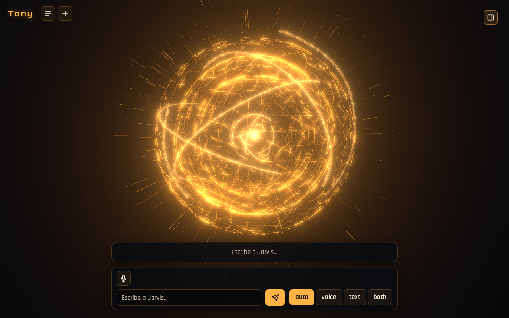

<div align="center">



# Tony

**Un asistente personal que vive en tu propio equipo, no en la nube de nadie.**

Hablas con **Jarvis** por voz o texto; cuando hace falta tocar ficheros, llamar a una
herramienta o consultar algo externo, Jarvis delega en **Viernes**, que ejecuta la
tarea con las herramientas (MCP) que le hayas dado. Todo corre en local: el motor, la
memoria, los logs y la voz.


</div>

---

## Qué es

**Tony** es un asistente de IA personal pensado para correr en tu propio equipo, con
dos agentes especializados en vez de uno genérico:

- **Jarvis** (`front`) es con quien hablas: conversa, responde directamente lo que
  puede y decide cuándo una petición necesita acción real.
- **Viernes** (`worker`) es quien actúa: ejecuta tareas apoyándose en los servidores
  MCP que le configures (ficheros, Notion, Google Calendar, lo que conectes), puede
  partir una tarea en subagentes especializados y pedir confirmación antes de una
  operación destructiva.

Por debajo hay un núcleo común: carga de agentes desde ficheros planos (`agent.md` +
`tool.json`), un gestor de MCP, un orquestador de tareas con delegación y subagentes,
memoria de usuario persistente, logging JSONL por tarea y **motores intercambiables**
— cada agente puede correr sobre el SDK de Claude (con tu cuenta) o sobre cualquier
proveedor compatible con LiteLLM (API key de OpenAI o Anthropic), eligiendo el motor
desde la propia interfaz web sin tocar código.

## Para qué sirve

- **Hablarle como a un asistente real** — por terminal (`tony chat`) o por voz y texto
  en el navegador (`tony web`), con micrófono, detección de voz, transcripción y
  respuesta hablada, todo con motores locales.
- **Delegarle tareas con herramientas** — Viernes conecta servidores MCP (ficheros,
  APIs, lo que sea) y los usa con permisos explícitos (`allow`/`confirm` por tool).
- **Extenderlo sin tocar código** — agentes, subagentes y skills se definen como
  carpetas y Markdown; añadir uno nuevo no requiere programar.
- **Elegir motor y cuenta** — cambiar entre tu cuenta de Claude o una API key de
  OpenAI/Anthropic desde la interfaz, sin reiniciar nada.
- **Auditar lo que hizo** — cada tarea queda en un JSONL legible, con tokens, coste y
  cada llamada a herramienta.

> **Estado del proyecto:** en desarrollo activo. La arquitectura y los comandos de
> este README son los actuales, pero cambian con frecuencia; cada cambio de fondo se
> describe primero como propuesta en `openspec/` antes de implementarse.

## Requisitos

- Python 3.12 gestionado con [uv](https://docs.astral.sh/uv/).
- Node.js con `npx` (para el MCP de filesystem).
- [Claude Code CLI](https://docs.claude.com/en/docs/claude-code) instalado y autenticado
  (`claude` en el PATH). Tony usa esa autenticación; no necesitas `ANTHROPIC_API_KEY`.

## Instalación

```bash
uv sync
uv run tony --help
```

## Primer uso con el MCP de filesystem

Viernes viene configurado con el MCP `@modelcontextprotocol/server-filesystem` sobre
`~/notas`. Crea la carpeta si no existe y precarga el servidor una vez (la primera descarga
de `npx` puede superar el timeout de conexión de 10 s; el comando arranca el servidor y
termina al cerrar la entrada estándar):

```bash
mkdir -p ~/notas
npx -y @modelcontextprotocol/server-filesystem@2026.8.31 ~/notas < /dev/null
```

Se fija la versión `2026.8.31` porque `2025.8.21` publica tools con `inputSchema` vacío
(sin `type: object`), que el cliente MCP rechaza y deja a Viernes sin tools.

Después ejecuta una tarea:

```bash
uv run tony run viernes "lista los .md de ~/notas y resume el más reciente"
uv run tony run viernes "lista los .md de ~/notas" --json
uv run tony version
```

Opciones de `tony run`: `--json` (imprime el `TaskResult` como JSON), `--agents-dir`
(directorio de agentes, por defecto `agents/`) y `--config` (por defecto
`config/tony.yaml`). Códigos de salida: `0` si el estado es `ok` o `partial`, `1` si es
`error`, `cancelled` o `timeout`, `2` si el agente no existe, no es `worker` o no carga.

## Conversar con Jarvis: `tony chat`

```bash
uv run tony chat            # continúa la última conversación de la terminal
uv run tony chat --new      # empieza una conversación nueva
uv run tony chat --help
```

Opciones: `--config` (por defecto `config/tony.yaml`), `--agents-dir` (por defecto
`agents/`) y `--new`. El prompt es `tú> `; las respuestas van a `stdout` y los avisos,
el progreso y las preguntas a `stderr`. Jarvis responde por sí mismo a la conversación,
las preguntas generales, la hora y tus preferencias, y delega en Viernes cuando hacen
falta ficheros, datos externos o herramientas. Mientras una tarea delegada corre verás
su progreso como líneas `· <tool>` y, si tarda más de 3 s, la frase de espera de Jarvis.

Comandos locales (no llegan a Jarvis):

| Comando | Efecto |
|---|---|
| `/mode` | Muestra el modo de respuesta persistido o, si no hay, el de `tony.yaml`. |
| `/mode auto\|voice\|text\|both` | Guarda el modo en `memory/settings.json`. |
| `/memoria` | Imprime `memory/preferences.md` completo. |
| `/cancel` | Cancela la tarea activa. |
| `/salir` | Termina (también `Ctrl+D`). |

Prefijos por mensaje: `/v texto`, `/t texto` y `/b texto` fuerzan `voice`, `text` o
`both` solo para ese mensaje, sin tocar los ajustes. La precedencia es prefijo >
`settings.json` > `tony.yaml`; `auto` se resuelve a `text` cuando escribes (a `voice`
cuando la entrada es audio, en entregas posteriores). En la terminal los modos de voz se
degradan a texto: primero `🔊 <resumen hablado>` y después la respuesta completa.

Confirmaciones: cuando Viernes necesita una tool de `confirm` (o marcada como
destructiva), verás `Viernes quiere ejecutar <tool> {...}. ¿Confirmas? [s/N]`. Solo `s`,
`si` o `sí` aprueban; Intro vacío o cualquier otra respuesta rechaza y la tarea termina
`cancelled`. Sin respuesta en `limits.confirm_timeout_s` (60 s) la tarea se cancela por
falta de confirmación y la sesión sigue.

`Ctrl+C` durante una tarea delegada la cancela y vuelve al prompt; un segundo `Ctrl+C`
(o `Ctrl+C` sin tarea en curso) cierra la sesión ordenadamente.

## Chat web: `tony web`

La misma sesión de chat de la terminal, servida en el navegador con streaming de eventos, botones
para confirmar tools, selector del modo de respuesta y un panel de debug (RF-20).

```bash
uv sync --extra web                                   # fastapi, uvicorn y websockets
cd tony/apps/web/frontend && npm install && npm run build && cd -
uv run tony web --open                                # http://127.0.0.1:8787/
uv run tony web --help
```

Opciones: `--port` y `--host` (por defecto `web.port` 8787 y `web.host` 127.0.0.1 de
`config/tony.yaml`), `--open` (abre el navegador al arrancar), `--allow-remote` (obligatorio para un
`--host` fuera de loopback; el servidor avisa de que no hay autenticación ni HTTPS), `--config` y
`--agents-dir` como en `tony chat`. Sin el extra, `tony web` termina con código 2 indicando
`uv sync --extra web`; sin el frontend compilado, `GET /` muestra una página con el comando de
`build`. `Ctrl+C` cierra los sockets (código 1001), cancela las tareas activas y para el servidor.

Política de `Origin`: toda petición mutante (`POST`, `PATCH`, `PUT`, `DELETE`) y toda conexión al
WebSocket deben llevar `Origin: http://<host>:<port>` (`localhost` y `127.0.0.1` se consideran
equivalentes); si no, `403 {"error": "forbidden_origin"}`. Los `GET` sin `Origin` (por ejemplo
`curl`) se aceptan. Para desarrollar el frontend, `npm run dev` levanta Vite en `:5173` con un
proxy a `127.0.0.1:8787` que reescribe el `Origin` solo en ese caso.

Streaming en v1: el motor del `front` devuelve la respuesta estructurada completa al final del turno
(sin fragmentos parciales), así que el navegador recibe `user.accepted` al instante, la burbuja de
espera y los eventos de tools, y un único `assistant.final`; el tipo `assistant.delta` forma parte del
protocolo y la UI lo soporta para cuando el motor entregue fragmentos.

Panel de debug (plegable, estado recordado en el navegador): árbol de la tarea raíz y sus
subagentes con estado, tool calls con argumentos redactados, duración y error, tokens y coste por
tarea y acumulados de la conversación, alerta "Tarea > 50 k tokens" cuando una tarea supera
`limits.token_alert`, ruta del JSONL de la tarea con botón de copia, eventos
`config.reloaded`/`config.reload_failed` y "Copiar JSON" con el árbol completo.

API HTTP (JSON; errores siempre `{"error", "detail"}`):

| Método y ruta | Respuesta |
|---|---|
| `GET /api/health` | `{status, version, front, worker, mcp: [{name, state, tool_count}]}` |
| `GET /api/settings` | `{reply_mode, reply_mode_source: "settings" \| "yaml"}` |
| `PATCH /api/settings` `{reply_mode}` | persiste en `memory/settings.json`; `422` si no es válido |
| `POST /api/tasks/{id}/confirm` `{confirmation_id, approved}` | `{ok: true}` o `409 invalid_confirmation` |
| `POST /api/tasks/{id}/cancel` | `{ok: true}`; `404 unknown_task` |
| `GET /api/conversations` | las 20 más recientes `{id, channel, created_at}` |
| `GET /api/conversations/{id}/messages` | `{id, role, content, reply_mode, created_at}`; `404 unknown_conversation` |
| `GET /api/memory` | `{content, lines}` de `memory/preferences.md` |

WebSocket `/ws/chat` (protocolo `v: 1`, sobre `{v, type, seq, conversation_id, message_id?,
task_id?, payload}`): el cliente envía `hello`, `user.text`, `confirm`, `cancel`, `set_mode`,
`audio.start`, `audio.end` y frames binarios de audio; el servidor responde `hello.ok`,
`user.accepted`, `assistant.delta`, `assistant.wait`, `assistant.final`, `usage`, los eventos
`task.*`/`tool.*`/`subtask.*`, `config.*`, `error` y los de voz `stt.final`, `tts.start`,
`tts.chunk.meta` (seguido de un frame binario), `tts.end` y `tts.cancelled`. Cada conversación
numera sus mensajes con `seq`; al reconectar, `hello {conversation_id, last_seq}` reenvía solo los
posteriores (o `resync: true` si son demasiado antiguos); los frames binarios no llevan `seq` ni se
reenvían. Mensajes de texto de más de 32 KiB se rechazan con cierre `1009`; un frame de audio de
más de 16 KiB responde `audio_frame_too_large` sin cerrar. `GET /api/health` incluye
`voice: {available, reason, stt, tts}`.

## Voz: micrófono, VAD, STT y TTS

Hablar con Jarvis y oírle funciona en local con tres motores: Silero VAD (detección de voz,
`onnxruntime`), faster-whisper `base` en CPU con pesos `int8` (transcripción) y Piper
(`es_MX-ald-medium`, síntesis); Kokoro sigue disponible como alternativa. Kokoro necesita
`espeak-ng` instalado en el sistema (en Bazzite/Fedora Atomic, `rpm-ostree install espeak-ng`; en
macOS, `brew install espeak-ng`); Piper trae su propio `espeak-ng`.

```bash
uv sync --extra web --extra voice     # motores en CPU: torch se resuelve del índice CPU de PyTorch
uv run tony voice warmup              # descarga los modelos a ~/.cache/huggingface/hub y los carga
uv run tony doctor --offline          # ✓ espeak-ng, voice.stt, voice.tts y voice-models
cd tony/apps/web/frontend && npm install && npm run build && cd -
uv run tony web --open
```

Sin el extra, `tony web` arranca con la voz desactivada: `GET /api/health` responde
`voice.available: false` con la razón, el botón de micrófono aparece deshabilitado con un tooltip
que indica `uv sync --extra voice` y `audio.start` responde `error voice_unavailable`.
`tony chat`, `tony run` y el resto de comandos no cambian.

En el navegador, el botón de micrófono (conmutable, `aria-pressed`) pide permiso, envía
`audio.start {sample_rate: 16000, channels: 1, format: "f32"}` y captura con un `AudioWorklet`
que re-muestrea a 16 kHz mono y envía frames de 30 ms (480 muestras Float32) como mensajes
binarios; un indicador de nivel acompaña a "Escuchando…". El servidor segmenta las intervenciones
con el VAD (fin de frase tras `voice.end_silence_ms`, 500 ms por defecto, de silencio; mínimo
300 ms de habla; corte a 30 s), transcribe
y emite `stt.final {text, message_id}`, que se procesa igual que un `user.text` con modalidad
`audio`: `auto` se resuelve a `voice`, los prefijos `/v`, `/t`, `/b` funcionan también dichos
("barra t qué hora es" no; el texto transcrito debe empezar por `/t`), y la transcripción aparece
como mensaje tuyo con un icono de micrófono y su modo efectivo.

Modos de respuesta por voz:

- Botón: el selector `auto | voice | text | both` persiste el modo (`PATCH /api/settings`).
- Por frase: "respóndeme por escrito" hace que Jarvis llame a `set_reply_mode("text")`; el selector
  lo refleja al terminar el turno y el siguiente mensaje se acepta en `text`.
- Por prefijo: `/v qué hora es` escrito fuerza voz solo en ese mensaje.

En `voice` y `both` la respuesta se habla en streaming: el `front` emite su salida estructurada
con `speech_text` primero y el servidor extrae ese campo del JSON parcial a medida que llega, lo
trocea y sintetiza cada pieza al momento (`display_text` llega como `assistant.delta`;
`assistant.final` sigue siendo la respuesta completa y autoritativa). La primera pieza se corta
en la primera cláusula (coma, dos puntos o punto y coma) o tras la sexta palabra, para que el
primer audio llegue cuanto antes; las siguientes son frases (`.`, `?`, `!`, `…`, `;`, doble salto
de línea; `Sr.`, `p. ej.`, `10.5`, `10,5` o `10:30` no cortan). Entre piezas se añaden pausas
naturales de 160 ms tras una frase y 80 ms tras una cláusula. Mensajes: `tts.start`,
`tts.chunk.meta {seq, sentence_index}` + frame binario PCM Int16 a 24 kHz, `tts.end`. El navegador
reproduce los frames en una cola sin huecos ("Hablando…") y muestra el botón "Detener audio", que
para el audio al instante, envía `cancel {message_id}` (respuesta `tts.cancelled`) y avisa con
`playback.stopped {message_id}`. Si el `front` no produce `speech_text` (por ejemplo una tabla o
código en `display_text`), se lee `display_text` sin markdown, truncado a 600 caracteres y con el
cierre "…te lo muestro en pantalla"; en pantalla siempre aparece `display_text` completo. Si la
síntesis falla, llega `tts.cancelled` + `error tts_failed` y la respuesta queda en texto. Cuando
Jarvis delega una tarea en modo hablado, suena al instante un acuse pregrabado
(`voice.acknowledgements`, en rotación: "Un momento, señor.") sintetizado una sola vez por voz.

Interrupción por voz (barge-in): el micrófono sigue abierto mientras Jarvis habla, con la
cancelación de eco, la supresión de ruido y el control de ganancia del navegador. Mientras suena
su voz (desde `tts.start` hasta `playback.stopped`, `tts.cancelled` o, si el cliente no avisa, el
fin estimado del audio más 2 s) el servidor clasifica cada ventana con un umbral más estricto
(`voice.barge_in_threshold`, 0,8) y, cuando una intervención acumula
`voice.barge_in_min_speech_ms` (280 ms) de habla, corta al instante todo el audio en curso con
`tts.cancelled`, registra `barge_in {message_id, speech_ms}` en el JSONL y, si el `front` sigue
generando, interrumpe su turno: `assistant.final` lleva lo dicho hasta entonces seguido de ` …`
(o `(interrumpido)`), sin `error`. La intervención se transcribe y responde como cualquier otra.
Filtro de eco: si la transcripción de una interrupción tiene al menos 3 palabras y está contenida
en lo que Jarvis estaba diciendo (sin mayúsculas, tildes ni puntuación), se descarta y se registra
`barge_in.echo {chars}`. Mientras Jarvis espera una tarea delegada solo se corta el audio: la
tarea sigue (cancélala desde la UI) y lo que digas recibe `turn_in_progress`. Con
`voice.barge_in: false` el servidor descarta lo que oye mientras Jarvis habla, como si la captura
estuviera silenciada. Si el navegador no cancela bien el eco de tus altavoces (Jarvis se
interrumpe a sí mismo), usa auriculares, sube `voice.barge_in_threshold` o desactiva el barge-in.

Privacidad: el audio solo vive en memoria (nunca en disco ni en SQLite); solo la transcripción se
persiste como mensaje de usuario. El JSONL de la sesión registra `stt.final {chars, duration_ms}` y
`tts {sentences, duration_ms, cancelled}`, nunca audio ni texto. Si una clave de `config/.env`
aparece en el texto hablado, se pronuncia "dato oculto" en vez de la máscara.

Configuración (`config/tony.yaml`, sección `voice`): `stt: faster-whisper/<modelo>` con `tiny`,
`base` (por defecto), `small`, `medium`, `large-v3` (y variantes `.en`/`distil`); `tts` es un
alias `motor/voz[?speed=…&lang=…]` (ver "Voz de Jarvis"); `vad: silero`; `end_silence_ms`
(silencio que cierra una intervención, 300–1500, 500 por defecto); `barge_in`,
`barge_in_threshold` (0,5–0,99) y `barge_in_min_speech_ms` (150–1000); `cpu_threads` (hilos de
faster-whisper y Kokoro; `null` = la mitad de los núcleos lógicos) y `acknowledgements` (1–10
frases de ≤ 60 caracteres). Un alias inválido es `✗` en `tony doctor` y en `tony config validate`.
El idioma del STT es `persona.language` del `front` (`es` por defecto).

### Voz de Jarvis

Voz por defecto: `piper/es_MX-ald-medium?speed=0.95`. Se eligió por el brief (masculina, español
latinoamericano neutro con seseo, serena y precisa): f0 ≈ 150 Hz, fonemas `es-419` nativos del
dataset mexicano y un primer fragmento de ~130–180 ms en CPU, frente a ~1,1 s (sin carga) de
Kokoro; `speed=0.95` da un ritmo calmado sin sonar lento. La alternativa para quien prime un
timbre más grave sobre la latencia es la mezcla de Kokoro `em_alex*0.6+em_santa*0.4` (f0 ≈ 126 Hz,
~1 s más hasta el primer audio). No se aplica procesado de tono.

Sintaxis del alias: `motor/voz[?clave=valor(&clave=valor)*]`.

- `speed`: 0,5–1,5 (1,0 por defecto), en Piper y Kokoro (Piper: `length_scale = 1/speed`).
- `lang`: solo Kokoro, `es-419` (seseo, por defecto) o `es` (pronunciación peninsular).
- Kokoro admite mezclas `voz*peso+voz*peso` cuyos pesos suman 1 (tolerancia 0,01) con `ef_dora`,
  `em_alex` y `em_santa`; Piper admite las voces españolas de su índice (`es_MX-ald-medium`,
  `es_MX-ald-x_low`, `es_MX-claude-high`, `es_AR-daniela-high` y las `es_ES-*`), que se
  descargan a la caché de Hugging Face (`rhasspy/piper-voices`) en el primer uso o con
  `tony voice warmup`. Piper genera a 22 050 Hz y se re-muestrea a 24 kHz.

```yaml
voice:
  tts: piper/es_MX-ald-medium?speed=0.95             # por defecto
  # tts: kokoro/em_alex*0.6+em_santa*0.4?speed=0.94  # más grave, ~1 s más lenta
  # tts: kokoro/ef_dora?lang=es                      # la voz anterior
  # stt: faster-whisper/small                        # el STT anterior, más lento
```

Paquete de escucha: `uv run python scripts/voice_samples.py` genera en `samples/voices/` (ignorado
por git) un WAV por candidata con el mismo párrafo ("Buenas tardes, señor. Los sistemas están en
línea…") e imprime esta tabla (primer fragmento de "Enseguida lo reviso, señor.", 5 repeticiones;
"mal oídas" son las palabras del párrafo que faster-whisper `base` no transcribe igual). Medido con
la máquina cargada (load average ~20), lo que infla sobre todo las cifras de Kokoro: sin carga, la
sonda midió ~1,1–1,2 s para `em_alex`, `em_santa` y la mezcla.

| Candidata | Alias para `voice.tts` | Primer fragmento p50 | f0 | Mal oídas | Notas |
|---|---|---|---|---|---|
| `piper_ald_medium_095.wav` | `piper/es_MX-ald-medium?speed=0.95` | 125 ms | 150 Hz | 2 | por defecto |
| `piper_ald_medium_100.wav` | `piper/es_MX-ald-medium` | 142 ms | 150 Hz | 0 | mismo timbre, ritmo normal |
| `piper_ald_x_low_095.wav` | `piper/es_MX-ald-x_low?speed=0.95` | 123 ms | 154 Hz | 8 | modelo pequeño, más metálico |
| `piper_claude_high_095.wav` | `piper/es_MX-claude-high?speed=0.95` | 118 ms | 185 Hz | 3 | tono más agudo |
| `kokoro_blend_alex_santa_es419.wav` | `kokoro/em_alex*0.6+em_santa*0.4?speed=0.94` | 3203 ms | 126 Hz | 1 | la más grave; alternativa documentada |
| `kokoro_em_alex_es419.wav` | `kokoro/em_alex?speed=0.94` | 2947 ms | 133 Hz | 3 | masculina, seseo |
| `kokoro_em_santa_es419.wav` | `kokoro/em_santa?speed=0.94` | 3914 ms | 143 Hz | 3 | masculina, seseo |
| `kokoro_ef_dora_es.wav` | `kokoro/ef_dora?lang=es` | 3437 ms | 168 Hz | 3 | voz anterior (femenina, peninsular) |

Licencias: `piper-tts` es GPL-3.0-or-later y solo se instala con el extra opcional `voice` (Tony es
de uso personal y local; si se distribuye, basta con cambiar `voice.tts` a `kokoro/…`, sin tocar
código). Las voces `es_MX-ald` (dataset Unlicense) y `es_MX-claude` (Apache-2.0) tienen licencias
permisivas.

Limitaciones: `AudioWorklet` y `getUserMedia` exigen un contexto seguro, así que con
`--allow-remote` sin HTTPS el micrófono no funciona fuera de `localhost`/`127.0.0.1`; no hay wake
word ni transcripciones parciales; hablar durante una tarea delegada no la interrumpe; el audio
perdido durante una reconexión no se reenvía (el texto sí); no hay voz en `tony chat`.

Pruebas con los motores reales (excluidas de `uv run pytest` por `addopts = "-m 'not voice'"`):

```bash
uv run pytest -m voice                # VAD, STT y TTS reales sobre WAV sintéticos (sin voz humana)
uv run tony voice bench               # p50/p95 de 5 repeticiones
TONY_EVALS=1 uv run tony voice bench  # además la ida y vuelta completa con el modelo
```

Medidas en un AMD Ryzen 5 7535U (12 hilos, 14 GB, sin GPU), modelos ya en caché. "Antes" es la
primera entrega de voz (Kokoro `ef_dora`, faster-whisper `small`, respuesta completa antes de
hablar); "después" es esta entrega (Piper `es_MX-ald-medium`, faster-whisper `base`, habla en
streaming desde la salida parcial del modelo):

| Medida | Antes p50 | Después p50 | Después p95 | Nota |
|---|---|---|---|---|
| `stt_3s` | 1 390 ms | 692 ms | 706 ms | transcripción de una muestra sintética de 3 s |
| `stt_utt` | — | 638 ms | 694 ms | transcripción de la pregunta real usada en `roundtrip` |
| `tts_12w` | 3 186 ms | 147 ms | 152 ms | primer motor completo, frase de 12 palabras |
| `tts_first` | — | 91 ms | 102 ms | primer fragmento corto ("Enseguida lo reviso, señor.") |
| `ttft` | — | 1 646 ms | 1 984 ms | tiempo hasta el primer token del modelo (claude-haiku) |
| `roundtrip` | 9 384 ms | 2 560 ms | 2 978 ms | turno completo del modelo + primera frase sintetizada (sin streaming) |
| `roundtrip_stream` | — | **3 085 ms** | 3 210 ms | fin de habla → primer `tts.chunk` real, con streaming de principio a fin |

Desglose de `roundtrip_stream`: 576 ms de silencio de cierre (`voice.end_silence_ms`) + 755 ms de
transcripción + 1 646 ms hasta el primer token del modelo + 107 ms del primer fragmento de Kokoro.

El objetivo de p50 ≤ 2 500 ms no se alcanza por unos 600 ms en esta CPU (`tony voice bench` lo
marca como "objetivo no alcanzado"), pero baja de 9,4 s a 3,1 s: el cambio de motor de síntesis
(Piper en vez de Kokoro) ahorra unos 3 s, hablar en streaming en vez de esperar la respuesta
completa ahorra otros 2-3 s según la frase, y `faster-whisper/base` en vez de `small` ahorra unos
700 ms. El cuello de botella que queda es el tiempo hasta el primer token del modelo (~1,6 s): no
depende de la voz y solo bajaría con `effort="low"` (ya activado) o con un modelo más rápido.
Opciones restantes: frases de confirmación más cortas en `style.voice`, o un equipo con más
núcleos; `compute_type` sigue fijo en `int8` en v1.

## Memoria

Tony crea `memory/` al primer uso (está ignorada por git):

- `memory/preferences.md`: una preferencia por línea con el formato
  `- [YYYY-MM-DD] texto`. Jarvis la amplía con la tool `remember` y tú puedes editarla a
  mano; se relee en cada turno y se inyectan como máximo las últimas
  `limits.memory_max_lines` (200) líneas, sin resumir ni borrar nada del fichero.
- `memory/settings.json`: ajustes persistentes, por ejemplo `{"reply_mode": "text"}`.
  Un fichero ausente o inválido equivale a ajustes vacíos (con un aviso en el log).
- `memory/conversations.sqlite`: conversaciones, mensajes (con su modo de respuesta) y
  tareas delegadas con estado, tokens y coste.

## Configuración

`config/tony.yaml` es opcional; cada campo ausente toma su valor por defecto (ver los
comentarios del fichero de ejemplo). `config/.env` (copia `config/.env.example`) guarda los
secretos que tus MCPs necesiten y nunca se versiona.

Los roles se asignan por configuración: `front: jarvis` y `worker: viernes` por defecto.
Puedes intercambiarlos (`front: viernes`, `worker: jarvis`); si el `role` declarado en
`agent.md` no coincide con el rol asignado, `tony chat` avisa por `stderr` y continúa.

## Definir un agente

Cada agente es una carpeta en `agents/<nombre>/`:

`agent.md` — frontmatter YAML + system prompt:

```markdown
---
name: viernes
role: worker            # front | worker
model: claude-haiku     # alias definido en models de tony.yaml; solo aplica al motor claude_sdk
effort: medium          # opcional: low | medium | high | xhigh | max (motor claude_sdk)
persona: {address: "", language: es}
style: {voice: "", text: ""}
max_steps: 20           # 1..200
wait_phrase: "Dame un momento."
---
Eres Viernes...
```

`tool/tool.json` — MCPs y políticas:

```json
{
  "mcpServers": {
    "filesystem": {"command": "npx", "args": ["-y", "@modelcontextprotocol/server-filesystem@2026.8.31", "${HOME}/notas"]},
    "notion": {"url": "https://mcp.notion.com/mcp", "headers": {"Authorization": "Bearer ${NOTION_TOKEN}"}}
  },
  "native": ["delegate", "remember", "set_reply_mode", "read_skill", "run_subagent"],
  "allow": ["filesystem.*", "notion.search"],
  "confirm": ["filesystem.write_file", "filesystem.edit_file", "filesystem.move_file"]
}
```

- Un servidor es stdio si tiene `command` y HTTP si tiene `url` (nunca ambos).
- `${VAR}` se sustituye con el entorno del proceso y `config/.env` (el entorno gana).
- `allow` ausente significa "todas las tools"; `allow: []` no deja ninguna.
- Las tools de `confirm` y las anotadas como destructivas por el MCP piden confirmación
  `[s/N]` en la terminal (60 s); si la rechazas, la tarea termina con `cancelled`.

## Skills

Una skill es conocimiento que el agente lee bajo demanda. Vive en
`agents/<agente>/skills/<nombre>/SKILL.md`:

```markdown
---
name: resumen-web                     # igual que la carpeta
description: Resume una página web en 5 viñetas con fuente y fecha.   # ≤ 200 caracteres
trigger: ["resume esta web", "resúmeme la página", "resume https"]    # opcional
---
1. Descarga la página con `fetch.fetch`...
```

- El system prompt del `front` y del `worker` solo incluye el índice `Skills disponibles:`
  (nombre y descripción); el cuerpo llega por la tool nativa `read_skill(nombre)` o se inyecta
  automáticamente como bloque `<skill name="…">…</skill>` cuando el texto del usuario (o el
  `objetivo`/`contexto` de la tarea) contiene una frase de `trigger`, sin distinguir mayúsculas
  ni acentos. Cada skill activada se inyecta una sola vez por turno.
- Una skill inválida (nombre distinto de la carpeta, `description` ausente o demasiado larga,
  frontmatter ausente) se registra como error (`tony agents`, `tony doctor`) y no bloquea al agente.
- Viernes incluye la skill `resumen-web`; `read_skill` se declara en `native` de `tool.json`.

## Subagentes

Un `worker` puede descomponer una tarea con la tool nativa `run_subagent(nombre, objetivo,
contexto, restricciones)`, que ejecuta `agents/<agente>/subagents/<nombre>/` (misma estructura
que un agente: `agent.md`, `skills/`, `tool/tool.json`) como subtarea del orquestador, con sesión
e historial propios, y devuelve su `TaskResult`. Viernes incluye el subagente `investigador`.

Permisos del hijo = intersección con los del padre:

| `allow` del padre | `tool.json` del hijo                        | catálogo efectivo del hijo   |
|-------------------|---------------------------------------------|------------------------------|
| `["fs.*"]`        | ausente o vacío                             | `fs.read_file`, `fs.write_file` (el catálogo exacto del padre) |
| `["fs.*"]`        | `allow: ["fs.read_file", "notion.*"]`       | `fs.read_file`               |
| ausente (todas)   | `allow: ["fs.read_file"]`                   | `fs.read_file`               |

- `confirm` del padre se hereda siempre; el hijo puede añadir entradas.
- El hijo puede declarar servidores MCP nuevos (se conectan solo para esa subtarea y pasan por
  el `allow` del padre) salvo que el padre sea a su vez un subagente. Un nombre repetido usa la
  definición del padre.
- Límites: profundidad máxima 1 (un subagente no carga `subagents/` ni expone `run_subagent`),
  máximo 2 subagentes concurrentes por tarea (el tercero espera), fecha límite compartida con la
  tarea padre (`task_timeout_s` desde que el padre entró en `running`) y la misma puerta de
  confirmación: la pregunta `[s/N]` del hijo aparece en la conversación y un rechazo cancela solo
  la subtarea.
- Los eventos del hijo llevan `task_id` propio y `parent_id`; el padre recibe
  `subtask.started {task_id, agent}` y `subtask.finished {task_id, status}`, y su log registra
  `tool.call`/`tool.result` de `tony.run_subagent`.
- En `tony run` no hay orquestador: `run_subagent` devuelve un `TaskResult` de error y se avisa
  al arrancar. Los subagentes funcionan en `tony chat` (y en el servidor web).

## Gestionar servidores MCP: `tony mcp`

```bash
uv run tony mcp add fetch -- uvx mcp-server-fetch --agent viernes          # stdio
uv run tony mcp add notion https://mcp.notion.com/mcp --agent viernes \
    --header "Authorization=Bearer \${NOTION_TOKEN}" --allow notion.search  # HTTP
uv run tony mcp add x -- cmd --agent viernes --env TOKEN=\${TOKEN}         # entorno del servidor
uv run tony mcp remove fetch --agent viernes
uv run tony mcp list [--agent viernes] [--no-connect]
```

`add` edita `agents/<agente>/tool/tool.json` de forma atómica (indentación 2, el resto del fichero
se conserva; se crea si no existe), conecta al servidor con `limits.mcp_connect_timeout_s` y
muestra `<nombre>: N tools (allow: todas|<patrones>)`. Si la conexión falla, la entrada queda
escrita igualmente con un aviso (código 0). Un nombre existente falla salvo con `--force`. Las
opciones se reconocen aunque vayan después de `--`; si el servidor tiene una opción homónima
(por ejemplo `--env`), pon la de Tony antes de `--`. `list` muestra
`agente | servidor | transporte | estado | tools | allow | confirm` (subagentes como
`viernes/investigador`); con `--no-connect` no arranca ningún proceso.

## Inventario de agentes: `tony agents`

```bash
uv run tony agents                      # nombre | rol | modelo | skills | MCP | nativas
uv run tony agents show viernes         # AgentSpec resuelto en YAML (secretos como ***)
uv run tony agents show viernes/investigador
```

Un agente, subagente o skill que no carga aparece con `✗` y el motivo sin impedir el listado.

## Diagnóstico: `tony doctor` y `tony config validate`

```bash
uv run tony doctor              # incluye una petición mínima a claude-haiku y conecta a cada MCP
uv run tony doctor --offline    # sin la petición al modelo
uv run tony config validate     # sin red ni procesos (lo mismo que usa la recarga en caliente)
```

Cada comprobación es una línea `✓`, `✗` (con una sugerencia debajo) o `·` (informativa): Python
3.12, CLI `claude`, modelo, `config/tony.yaml`, `config/.env` (debe existir con permisos `600`),
cada agente, subagente y skill (incluidas las variables `${VAR}`), `node`/`npx` si algún MCP los
usa, el extra de voz, `espeak-ng` y la caché de modelos (solo informan), los alias `voice.stt` y
`voice.tts` (`✗` si son inválidos), conexión a cada MCP y patrones de `allow`/`confirm` que no
coinciden con ninguna tool. El código de salida es `1` si hay algún `✗`.

## Recarga en caliente de `tool.json`

Mientras `tony chat` está en marcha, Tony observa `agents/**/tool/tool.json`. Al guardar el del
`worker` (o el de uno de sus subagentes) se valida la configuración como `tony config validate`;
si es válida arranca una nueva generación de servidores MCP para las tareas nuevas (las tareas en
curso conservan la anterior, que se cierra cuando ninguna la usa) y se avisa en la terminal con el
evento `config.reloaded {agent, servers}`. Si no es válida (JSON mal formado, `${VAR}` sin
definir…) se conserva la última configuración válida y se emite `config.reload_failed {agent,
error}`. `agent.md`, las skills y `tony.yaml` siguen exigiendo reiniciar; un cambio en la carpeta
del `front` solo produce un aviso. `tony run` no observa nada.

## Logs

Cada tarea escribe `logs/<YYYYMMDD>/<task_id>.jsonl` con un evento por línea
(`mcp.status`, `task.started`, `tool.call`, `tool.result`, `assistant.text`, `task.finished`). La ruta
aparece en la última línea de la salida de `tony run`. Las tareas delegadas desde
`tony chat` añaden los eventos del orquestador (`task.queued`, `task.running`,
`task.progress`, `task.needs_confirmation`, `task.confirmed`, `task.cancelled` y
`task.result` como última línea) y cada conversación escribe además
`logs/<YYYYMMDD>/chat-<conversation_id>.jsonl` con el texto de Jarvis.

Antes de escribir, Tony redacta con `***` los valores de las claves `authorization`,
`api_key` y `token` (sin distinguir mayúsculas) y cualquier valor de `config/.env` de
8 o más caracteres; los valores más cortos (por ejemplo un puerto) no se redactan.

## Desarrollo

```bash
uv run pytest -q        # suite sin red, modelo ni motores de voz (< 60 s); tests/apps/web/ requiere el extra web
uv run pytest -m voice  # motores de voz reales (requiere uv sync --extra voice y los modelos en caché)
uv run ruff check .
cd tony/apps/web/frontend && npm test && npm run lint && npm run build   # frontend (Vitest + tsc)
```

### Evals

`evals/tareas.yaml` (6 tareas del worker sobre un MCP de ficheros falso) y
`evals/conversaciones.yaml` (4 conversaciones del front) describen cada eval y sus expectativas
(`status`, `tools_called_any`, `tools_called_all`, `resumen_contains`; `delegates`,
`reply_contains`, `judge`). No forman parte de `uv run pytest`:

```bash
uv run pytest evals/ -m evals                 # reproduce evals/fixtures/<id>.jsonl, sin red
TONY_EVALS=1 uv run pytest evals/ -m evals    # modelo real; graba evals/runs/<fecha>/<id>.jsonl
uv run tony replay logs/<fecha>/<task_id>.jsonl                  # eventos legibles, sin ejecutar tools
uv run tony replay evals/runs/<fecha>/fs-list-md.jsonl --to-eval fs-list-md [--force]
```

Con `TONY_EVALS=1` el juez (`claude-haiku`) evalúa el criterio `judge` de cada turno. `--to-eval`
escribe `evals/fixtures/<id>.jsonl` e imprime la entrada YAML con el `status` y las tools
observadas; los fixtures de conversación son el propio run copiado. `evals/runs/` está ignorado
por git.

### Motor y cuenta en la interfaz web

El selector **Motor** permite elegir **Claude · mi cuenta**, **OpenAI · API key** o
**Anthropic · API key**, además de los perfiles personalizados de `config/tony.yaml`.

- Para la opción de cuenta, inicia sesión en el equipo donde corre Tony con
  `claude auth login`. Tony comprueba el método de autenticación; no cambia
  automáticamente a facturación de API si falta la sesión.
- Para una API, elige proveedor, escribe el modelo y pega la clave en el campo
  **API key**. Pulsa **Guardar** y después **Usar este motor**. La API usa la
  facturación de esa clave. Puedes reemplazar o eliminar la clave; si ese motor
  está activo, selecciona primero otro motor.
- La elección se aplica a respuestas, tareas nuevas y subagentes, y se conserva
  al reiniciar. Cambiar abre una conversación nueva y conserva el historial.
  No se permite cambiar mientras haya una respuesta, tarea o captura de audio activa.

Las claves y la selección se guardan junto a `tony.yaml`, en `engine-auth.json`,
con permisos `0600` y excluidas de Git. El archivo contiene las claves en texto
local: no es un almacén cifrado. La API de la interfaz devuelve únicamente si
hay una clave configurada. No pegues las claves en el chat.

Los perfiles personalizados conservan su autenticación configurada; las opciones
con **mi cuenta** fuerzan autenticación de cuenta. Los identificadores
`claude-account`, `openai-api` y `anthropic-api` están reservados.
