<div align="center">

<h1>
  
  
  
</h1>

**Asistente personal local, con tres agentes de rol fijo y un guardián de permisos.**

Jarvis conversa, Viernes ejecuta, Edith decide qué se puede hacer sin preguntar y qué necesita tu
confirmación. Todo corre en tu máquina: el modelo es la única pieza remota (vía el SDK de Claude).


[Qué es](#qué-es) ·
[Cómo está montado](#cómo-está-montado) ·
[Flujos](#los-flujos-de-tony) ·
[Instalación](#instalación) ·
[Referencia técnica](#referencia-técnica)

</div>

---

## Qué es

Tony es un asistente personal que vive en tu escritorio (o en la terminal). Le hablas o le
escribes, y él hace cosas: lee y escribe tus notas, consulta tu calendario, busca en tu Drive,
gestiona tu correo, usa tu vault de Obsidian, pone música — lo que le conectes. Todo con un
principio simple: **ninguna acción real ocurre sin que una política explícita la permita**, y las
que importan te las pregunta antes de hacerlas.

No hay un único modelo haciendo de todo. Hay **tres agentes con un papel fijo cada uno**, y un
cuarto rol —el guardián— que no es un agente que decide con criterio propio, sino una política
determinista (YAML, sin modelo) que se evalúa antes de cada acción.

| Agente | Rol | Qué hace | Color |
|---|---|---|---|
| 🗣️ **Jarvis** | `front` | Habla contigo, entiende lo que pides y se lo encarga a Viernes | 🔵 `#2F6FED` |
| 🛠️ **Viernes** | `worker` | Ejecuta la tarea: usa tools, servidores MCP, skills y subagentes | 🟢 `#2E9E5B` |
| 🛡️ **Edith** | `guard` | Antes de cada tool, decide `allow` / `confirm` / `deny` según la política | 🟡 `#E0A100` |

### Qué puede hacer hoy

| Capacidad | Qué resuelve | Dónde verla |
|---|---|---|
| **Aprobaciones atadas** | Tu «sí» vale solo para esos argumentos exactos, con vista previa y caducidad | [Aprobaciones](#aprobaciones-atadas-a-los-argumentos) |
| **Diario de acciones** | Registro durable de cada tool que tocó algo; sabe qué pasó aunque se caiga | [Diario](#diario-de-acciones) |
| **Recuperación y deshacer** | Reanuda una tarea interrumpida sin repetir lo hecho y deshace escrituras de ficheros | [Recuperación](#recuperación-y-deshacer) |
| **Rutinas** | «Cada mañana resume mis tareas», bajo el mismo guardián que cualquier tarea | [Rutinas](#rutinas-programadas) |
| **Aclaraciones en la tarea** | Viernes te pregunta lo que le falta en vez de adivinar o abortar | [Aclaraciones](#aclaraciones-en-mitad-de-una-tarea) |
| **Respuestas con fuentes** | Cada fuente citada se verifica contra lo que las tools devolvieron de verdad | [Evidencia](#respuestas-con-fuentes-verificadas) |
| **Conectores aislados** | Un servidor MCP puede ver solo las variables de entorno que le des | [Conectores](#conectores-mcp-arranque-recuperación-y-aislamiento) |
| **Contexto y coste acotados** | Tope al tamaño de lo que llega al modelo; uso de caché y coste visibles | [Contexto y coste](#contexto-acotado-y-coste-visible) |
| **Conversaciones** | Retoma, busca y borra conversaciones guardadas | [Conversaciones](#conversaciones-guardadas) |
| **Doctor y política** | Diagnostica la instalación y explica, simula y revoca permisos | [Doctor y política](#diagnóstico-y-gestión-de-permisos) |
| **Voz con métricas** | Latencia por etapa (p50/p95) para medir la voz sin adivinar | [Voz](#voz) |
| **Temas visuales** | Holo Ámbar, Aurora e Instrumento, cada uno con su propio orbe | [Temas](#temas-y-orbe) |

---

## Cómo está montado

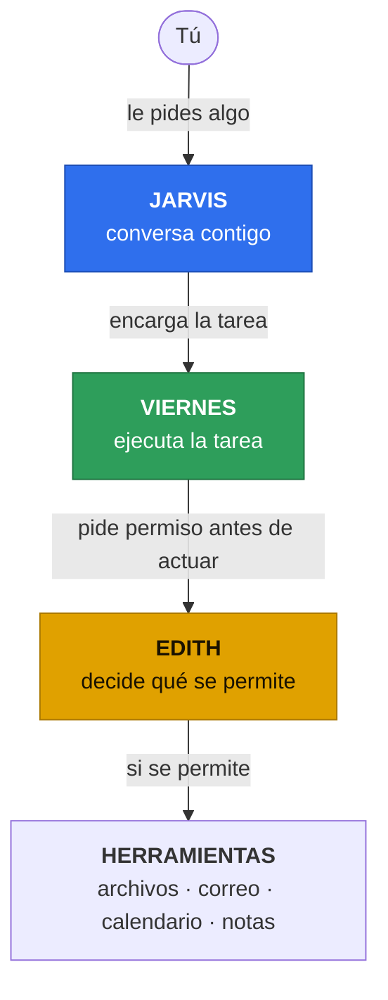

- **Jarvis** nunca toca una tool directamente: todo lo que requiere actuar en el mundo real pasa
  por `delegate` a Viernes.
- **Viernes** recibe una tarea estructurada (`objetivo`, `contexto`, `restricciones`) y la resuelve
  llamando a tools: de un servidor MCP (`<servidor>.<tool>`), nativas (`tony.<nombre>`) o, si la
  tarea lo pide, un subagente suyo.
- **Edith** no es un paso opcional: **toda** llamada a tool de Viernes pasa primero por su
  política, determinista y sin modelo detrás (el modelo de Edith solo redacta la *pregunta* cuando
  hace falta confirmar — nunca decide el veredicto).

Por dentro hay dos partes: la **interfaz**, que es lo que ves y solo envía tus órdenes, y el
**núcleo**, donde trabajan los agentes. Si el núcleo falla, la interfaz sigue abierta y te lo
muestra en el chat.

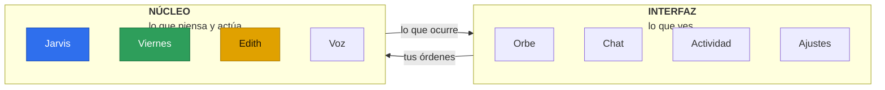

### El mapa completo

Todas las piezas, incluidas las más recientes, y quién habla con quién:

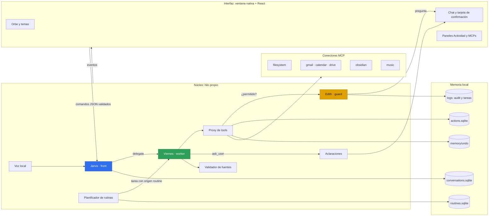

---

## Los flujos de Tony

### El flujo de una tarea

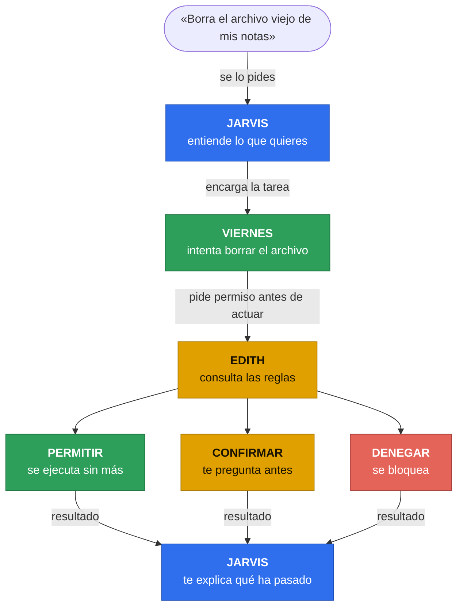

| Veredicto | Qué pasa |
|---|---|
| `allow` | la tool se ejecuta directamente |
| `confirm` | Edith pregunta «Acción: borrar X. Regla: r. ¿Autoriza?»; si dices que sí, se ejecuta — si no, o se agota el tiempo, no |
| `deny` | no se ejecuta; Viernes recibe `{"error": "blocked_by_policy"}` |

Así se ve el recorrido completo de una llamada con confirmación, de la petición al diario:

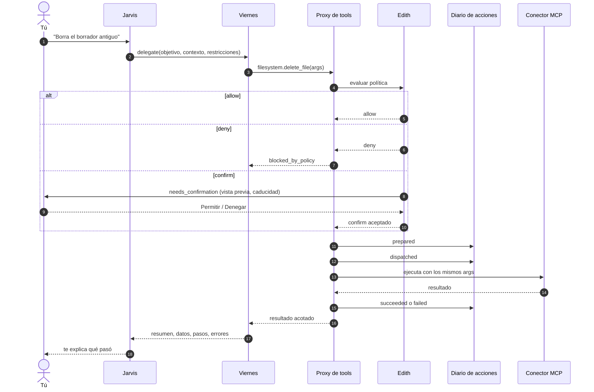

Cada veredicto queda en `logs/audit.jsonl` (`tony audit`), y cada tarea en
`logs/tasks/<task_id>.jsonl`. Nada de esto usa el modelo para decidir: la política es un YAML que
lees y editas tú.

### Aprobaciones atadas a los argumentos

Antes, un «sí» aprobaba el nombre de una tool y una vista previa de 200 caracteres. Ahora cada
pregunta de Edith es una **aprobación** con identidad propia: `approval_id`, `args_digest` (huella
de los argumentos), `policy_version`, `expires_at` y una **vista previa tipada** con el contenido
real: destinatarios y cuerpo de un correo, ruta y contenido de un fichero, campos de un evento de
calendario (con secretos enmascarados y tamaño acotado).

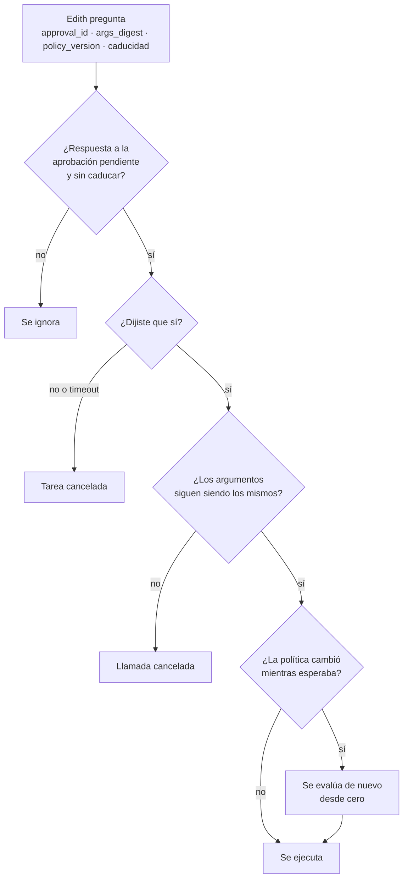

Nada de esto concede permisos nuevos: no se salta una confirmación ni el PIN, y el texto que
escribe el modelo nunca cambia la política. Una respuesta sin `approval_id` sigue valiendo cuando
solo hay una aprobación pendiente.

### Diario de acciones

El proxy de tools escribe en `memory/actions.sqlite` el estado de cada llamada que puede tocar el
mundo. Si la app se cae a mitad de una llamada, al arrancar las que quedaron en `dispatched` pasan
a `outcome_unknown`: Tony sabe que **no sabe** si se envió el correo, y nunca la repite solo.

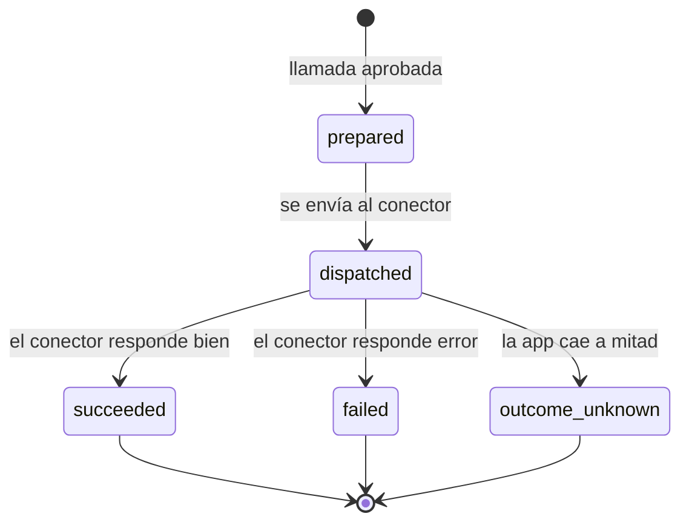

```bash
uv run tony actions list                        # las más recientes primero
uv run tony actions list --state outcome_unknown --limit 5
uv run tony actions show <CALL_ID>              # todos los campos de una llamada
```

### Recuperación y deshacer

Una tarea cancelada, con timeout o interrumpida deja efectos a medias. Tony te deja ver qué ya
ocurrió, continuar sin repetirlo o revertir una escritura de fichero.

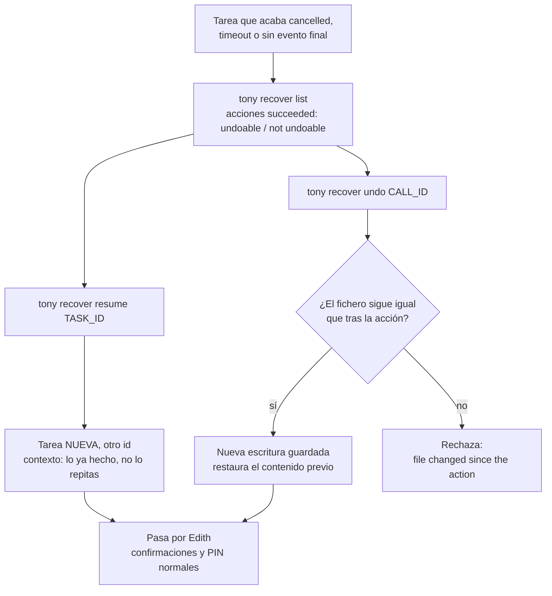

Antes de cada `filesystem.write_file` se guarda el contenido previo (hasta 1 MB, UTF-8) en
`memory/undo/<call_id>` y el hash de lo escrito en el diario. Reanudar y deshacer pasan por Edith
como cualquier llamada y **no reutilizan aprobaciones antiguas**.

### Rutinas programadas

«Cada mañana a las 8:30, resume mis tareas.» Una rutina es una tarea de Viernes con origen
`routine` que se lanza sola a su hora. Programar nunca autoriza nada.

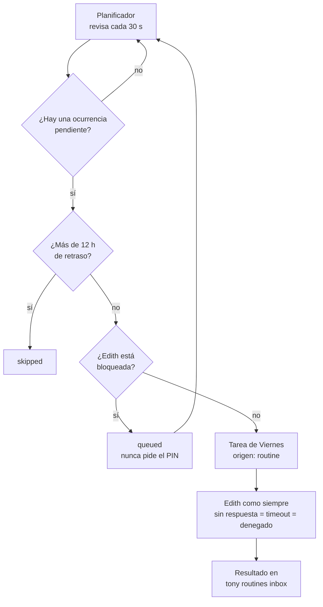

Las rutinas **solo se ejecutan mientras `tony chat` o la app de escritorio están en marcha**.

### Aclaraciones en mitad de una tarea

Si a Viernes le falta un dato (¿qué cuenta?, ¿qué fichero?), ya no adivina ni aborta: usa la tool
nativa `tony.ask_user` y la tarea **continúa** con tu respuesta.

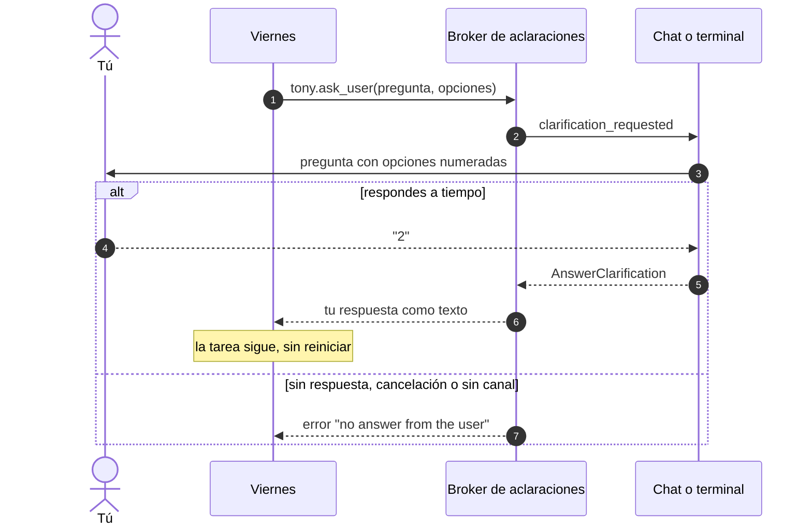

Es un canal **separado** de las confirmaciones: una respuesta de aclaración nunca es una
aprobación. La espera tiene el límite de `confirm_timeout_s`. Hoy la pregunta se muestra en
`tony chat` y `tony run`.

### Respuestas con fuentes verificadas

Un worker puede afirmar cosas sin que veas de dónde salen. Ahora cita sus fuentes y Tony las
comprueba contra lo que las tools **realmente devolvieron** antes de dártelas.

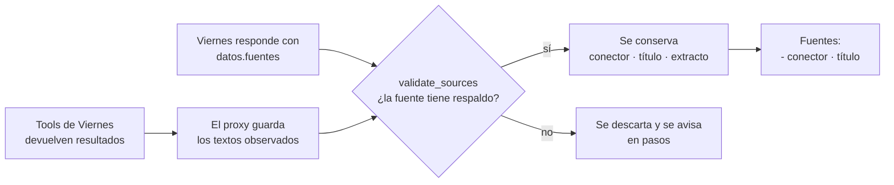

El resultado de la tarea mantiene sus cuatro campos (`resumen`, `datos`, `pasos`, `errores`); las
fuentes viajan dentro de `datos.fuentes`. La skill `evidencia` de Viernes le enseña a citarlas.

### Conectores MCP: arranque, recuperación y aislamiento

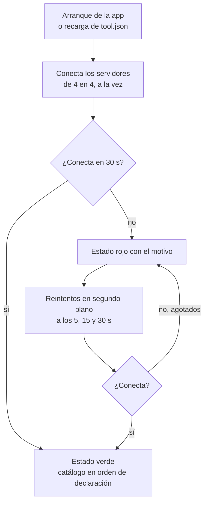

- **Arranque concurrente**: antes N servidores caídos retrasaban N × 30 s; ahora se conectan a la
  vez (máximo 4) y cada uno abre y cierra su propia conexión.
- **Recuperación viva**: la comprobación de arranque se mantiene abierta hasta que cada servidor
  caído se recupera, agota sus reintentos, lo sustituye una comprobación más nueva o la app se
  cierra.
- **Aislamiento opt-in**: un servidor stdio puede declarar `isolation.env_allow` y solo ve esas
  variables más `PATH`, `HOME`, `LANG` y `LC_ALL`. No es un sandbox ni concede permisos.

### Contexto acotado y coste visible

Dos cosas llegaban al modelo sin tope: el texto completo de cada resultado de tool y hasta 20
mensajes de historial, sin importar su longitud. Ahora ambos tienen un presupuesto generoso.

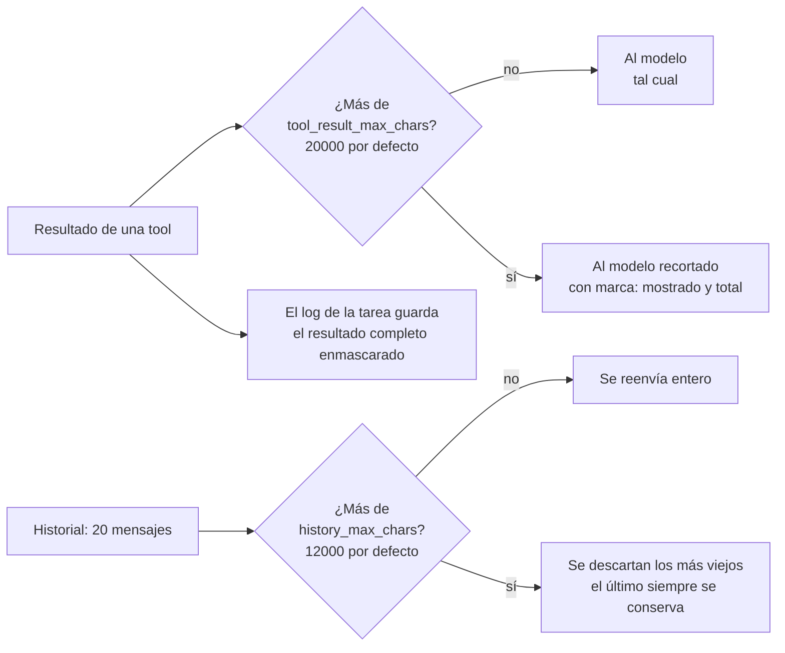

Con `0` en cualquiera de los dos límites se desactiva. Los resultados de error nunca se recortan y
el historial guardado no se toca. Además, `token_usage` en el log de tareas registra los tokens de
**caché** y el **coste en USD** (`null` si el SDK no lo informa, nunca 0), y la redacción de las
preguntas de confirmación idénticas se reutiliza en vez de volver a pedirla al modelo (las
decisiones de permiso nunca se cachean).

### Conversaciones guardadas

Cada arranque abre una conversación nueva, pero ya puedes volver a una anterior:

```bash
uv run tony chat --resume              # retoma la más reciente
uv run tony chat --resume <ID>         # retoma una concreta
uv run tony conversations list         # las más recientes primero
uv run tony conversations search "factura"
uv run tony conversations delete <ID>
```

Reanudar solo cambia la conversación a la que van los mensajes nuevos: no se repite nada y **no se
restaura ningún permiso ni aprobación**.

### Diagnóstico y gestión de permisos

```bash
uv run tony doctor                     # comprueba la instalación sin arrancar ni conectar nada
uv run tony policy explain shell.run --args '{"cmd": "ls"}'
uv run tony policy grants              # qué tools tienen «Permitir siempre»
uv run tony policy revoke filesystem.delete_file
uv run tony policy simulate evals/politica.yaml
```

`tony doctor` imprime una tabla `check | status | hint` con `ok`, `warn` o `fail` y sale con
código 1 si hay algún `fail`. Revisa que las definiciones carguen, que los comandos y URLs de los
servidores MCP existan, que los `${NOMBRE}` estén definidos, que haya dependencias opcionales de
voz y música y que cada variable de `env_allow` exista en el host. `revoke` y `simulate` solo los
ejecuta el usuario desde la CLI: no son tools del modelo.

### La voz

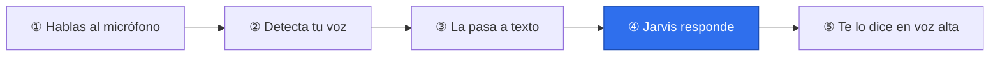

La voz es local (detalle en [Voz](#voz)). Si quieres medirla, un registrador de etapas opcional
anota solo marcas de tiempo, nunca audio ni texto, y la prueba de latencia imprime p50 y p95 en
frío y en caliente:

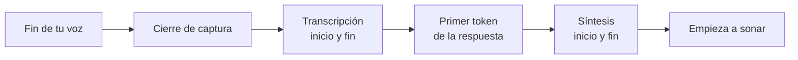

### Temas y orbe

Desde el botón de ajustes de la app (**«Ajustes de audio y apariencia»**) eliges entre tres
direcciones visuales. El cambio es inmediato, se guarda y cada tema trae su propio orbe:

| Tema | Aspecto | Orbe |
|---|---|---|
| **Holo Ámbar** (por defecto) | HUD ámbar sobre negro con esquinas marcadas | Wireframe geodésico en WebGL, con anillos y núcleo que late |
| **Aurora** | Cristal translúcido, botones en píldora | Gota líquida con degradado cónico (Canvas 2D) |
| **Instrumento** | Grafito con acabados metálicos | Dial radial que mide la voz y barre al pensar (Canvas 2D) |

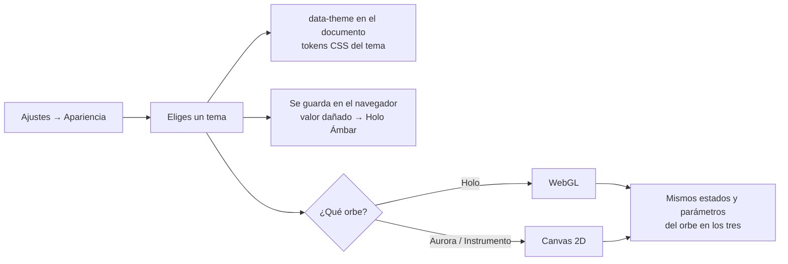

---

## El orbe: en qué estado está Tony

En la app de escritorio, el orbe central siempre refleja un estado — no hace falta leer logs para
saber qué está haciendo Tony, sea cual sea el tema:

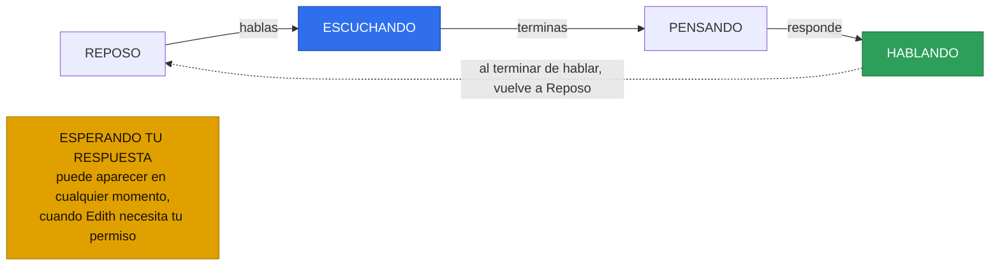

El orbe pasa de **Reposo** a **Escuchando** cuando hablas, a **Pensando** mientras Jarvis y Viernes
trabajan y a **Hablando** cuando responde. Si Edith necesita tu permiso, aparece **Esperando tu
respuesta**. Su tamaño sigue el nivel de la voz; con `prefers-reduced-motion` el movimiento se
anula y solo cambia el brillo, y sin WebGL el tema Holo muestra una versión estática, pero el
estado se nota igual por el halo y el color.

---

## Agentes, skills y subagentes

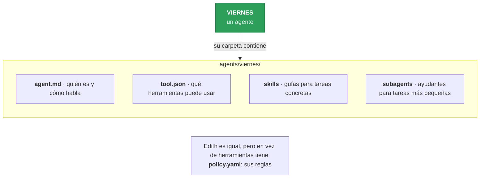

- **`agent.md`**: frontmatter (`name`, `role`, `model`, `persona`, `voice.tts`) + el prompt de
  sistema en Markdown.
- **`tool.json`**: qué servidores MCP tiene el agente (`command`/`args`/`env` para stdio, o
  `url`/`headers` para HTTP) y qué tools nativas (`read_skill`, `run_subagent`, `ask_user`). Nunca
  contiene permisos — esos viven solo en `policy.yaml`.
- **Skills** (`skills/<nombre>/SKILL.md`): procedimientos en Markdown que el agente lee bajo
  demanda con `tony.read_skill`; se listan en su prompt pero el cuerpo no se carga hasta que hace
  falta. Viernes trae `calendario`, `correo`, `drive`, `evidencia`, `musica` y `obsidian`.
- **Subagentes** (`subagents/<nombre>/`): un worker más, con su propio `tool.json`, invocado con
  `tony.run_subagent`; comparte el id de tarea, el log y el presupuesto de tiempo de la tarea
  padre, y Edith evalúa sus tools igual que las del agente principal.

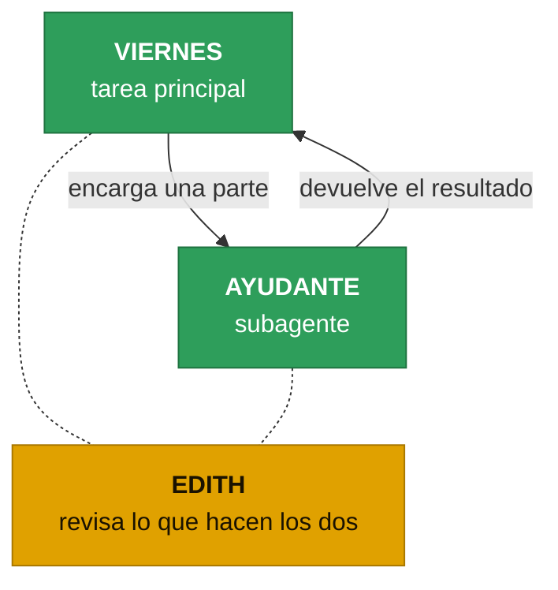

## Edith: la política de permisos

```yaml
default: confirm
rules:
  - match: "filesystem.read_*"          # patrón fnmatch, o lista de patrones
    verdict: allow
  - match: "filesystem.write_file"
    verdict: confirm
    when:
      path_outside: ["~/notas", "~/proyectos"]   # solo confirma si sale de esas carpetas
  - match: "gmail.send_email"
    verdict: confirm
  - match: "shell.run"
    verdict: deny
    when:
      args_regex: "(rm -rf|sudo)"
limits: {tool_timeout_s: 20, task_timeout_s: 300, confirm_timeout_s: 60}
auth: {pin_required: true, lock_after_min: 30}
```

Las reglas se recorren en orden; gana la primera cuyo patrón encaja con la tool (`<servidor>.
<tool>` o `tony.<nativa>`) **y** cuyas condiciones `when` se cumplen todas. Sin ninguna regla
ganadora, manda `default`. Es determinista: la misma llamada, con la misma política, siempre da el
mismo veredicto — no hay modelo de por medio en la decisión.

Las tareas delegadas exigen además que la sesión esté desbloqueada con un **PIN** (`tony pin set`,
guardado como hash argon2, nunca en claro), y toda decisión queda en `logs/audit.jsonl`
(`tony audit`). Para ver por qué una llamada recibe un veredicto usa `tony policy explain`. Detalle
completo de reglas, `when`, PIN y auditoría en la [referencia técnica](#referencia-técnica) más
abajo.

---

## Instalación

Requisitos: Python 3.12, [uv](https://docs.astral.sh/uv/) y Node.js ≥ 20 con `npm`/`npx`
(para el servidor MCP de ficheros y para compilar la interfaz). Para el modelo real hacen falta
credenciales de Claude disponibles para el Claude Agent SDK.

```bash
uv sync
uv run tony --help
uv run tony doctor        # comprueba que todo está en su sitio
```

Compilar la interfaz de la app de escritorio (una vez; Node solo hace falta para compilar, la app
no abre ningún servidor):

```bash
npm --prefix tony/apps/desktop/web ci && npm --prefix tony/apps/desktop/web run build
```

Voz e integración con el escritorio son extras opcionales:

```bash
uv sync --extra voice --extra desktop
```

Tony usa como raíz el directorio de `TONY_HOME` o, si no existe, el directorio actual.

## Uso rápido

```bash
uv run tony                          # abre la app de escritorio (orbe + chat)
uv run tony chat                     # conversación por terminal
uv run tony run viernes "Lista mis notas"   # ejecuta una tarea puntual y la imprime en JSON
```

Todos los comandos de la CLI:

| Comando | Para qué |
|---|---|
| `tony` · `tony --focus` | abre la app · la levanta y empieza a escuchar |
| `tony chat [--resume [ID]]` | conversación por terminal, nueva o retomada |
| `tony run <agente> "<tarea>"` | una tarea puntual con resultado JSON |
| `tony agents` | qué agente ocupa cada rol, con su modelo y voz |
| `tony mcp add \| list` | gestionar y listar los servidores MCP |
| `tony pin set` | fijar el PIN de Edith |
| `tony audit [--today] [--verdict V]` | auditoría de permisos |
| `tony policy explain \| grants \| revoke \| simulate` | inspeccionar y gestionar la política |
| `tony doctor` | diagnóstico local de la instalación |
| `tony conversations list \| search \| delete` | gestionar conversaciones guardadas |
| `tony actions list \| show` | diario de acciones ejecutadas |
| `tony recover list \| resume \| undo` | recuperar tareas y deshacer escrituras |
| `tony routines add \| list \| inbox \| enable \| disable \| remove` | rutinas programadas |

---

## Referencia técnica

Lo de abajo es la documentación exhaustiva: cada campo, cada regla, cada mensaje de error. Si
solo quieres entender qué es Tony y cómo fluye una tarea, con lo de arriba ya tienes lo esencial.

### `config/tony.yaml`

Opcional. Las claves que falten toman su valor por defecto y las desconocidas se rechazan con un
error que nombra el fichero y el campo. El fichero incluido documenta todos los valores por
defecto: agentes `front`/`worker`/`guard`, `reply_mode` (`auto|voice|text|both`), alias de modelos
(`claude-haiku`, `claude-sonnet`), `voice` y `desktop`. `history_max_chars` (12000 por defecto,
`0` lo desactiva) limita los caracteres del historial que se reenvían al modelo.

### `config/.env`

Opcional y fuera de git. Contiene solo secretos (`NOMBRE=valor`); el entorno del proceso tiene
prioridad. Los valores llegan a los servidores MCP mediante marcadores `${NOMBRE}` en `tool.json`,
resueltos al arrancar cada servidor con `config/.env` y el entorno del proceso. Plantilla:
`config/.env.example`.

Qué es un secreto:

- todo valor no vacío definido en `config/.env` (aunque ningún servidor lo use);
- el valor de cualquier marcador cuyo nombre de variable encaje con
  `(?i)(token|key|secret|password|passwd|authorization|pin)`, venga de donde venga.

Los secretos se sustituyen por `***` en los resultados de tools, el log de tareas, la auditoría y
la salida de la CLI. Las demás variables del proceso (por ejemplo `${HOME}`) se resuelven pero no
se enmascaran.

### Agentes: `agents/<nombre>/`

```
agents/viernes/
├── agent.md          # frontmatter YAML + prompt de sistema en Markdown
├── tool/tool.json    # servidores MCP y tools nativas
└── skills/           # calendario, correo, drive, evidencia, musica, obsidian
agents/edith/
├── agent.md          # role: guard; redacta las preguntas de confirmación
└── policy.yaml       # política de permisos (Edith no tiene carpeta tool/)
```

`agent.md` exige exactamente estos campos: `name` (igual a la carpeta), `role`
(`front|worker|guard`), `model` (un alias de `config/tony.yaml`), `persona.language`,
`persona.tone` y `voice.tts` (`kokoro/<voz>` o una mezcla `kokoro/<voz>,<voz>`, p. ej.
`kokoro/ef_dora,bf_emma`, que promedia esas voces de Kokoro), más el campo opcional `description`
(texto no vacío). El cuerpo es el prompt de sistema y no puede estar vacío.

`tool/tool.json`:

```json
{
  "mcpServers": {
    "filesystem": {"command": "npx", "args": ["-y", "@modelcontextprotocol/server-filesystem", "${HOME}/notas"]},
    "remote": {"url": "https://example.test/mcp", "headers": {"Authorization": "Bearer ${REMOTE_TOKEN}"}}
  },
  "native": ["read_skill", "run_subagent", "ask_user"]
}
```

Cada servidor define `command` (stdio, con `args` y `env` opcionales) o `url` (HTTP streamable,
con `headers` opcionales), nunca ambos. Las tools se identifican como `<servidor>.<tool>`; el
nombre de servidor `tony` está reservado para las tools nativas (`tony.<nombre>`). Las claves
`allow` y `confirm` se rechazan: los permisos pertenecen a `agents/edith/policy.yaml`. Los nombres
de servidor solo admiten letras y dígitos separados por un único `-` o `_` (sin `.` ni `__`). Las
tools nativas disponibles son `read_skill`, `run_subagent` y `ask_user`.

Un servidor stdio puede declarar `"isolation": {"env_allow": ["GITHUB_TOKEN"]}` para limitar su
entorno (solo POSIX): el proceso recibe únicamente las variables de `env_allow` presentes en el
host, su `env` declarado (que prevalece sobre el valor del host) y `PATH`, `HOME`, `LANG` y
`LC_ALL`; `USER`, `SHELL`, `TERM`, `LOGNAME` y el resto no existen. Sin `isolation` nada cambia.
No es un sandbox ni concede permisos: la confirmación y el PIN siguen aplicándose. `tony doctor`
avisa (`warn`) si una variable de `env_allow` no está definida en el host.

#### Skills: `agents/<agente>/skills/<nombre>/SKILL.md`

Una skill es una carpeta con un `SKILL.md`: frontmatter con exactamente `name` (igual a la
carpeta) y `description` (no vacía), seguido de un cuerpo Markdown no vacío.

```markdown
---
name: resumir
description: Resume notas en tres viñetas
---
Paso 1...
```

Si el agente declara la nativa `read_skill`, su prompt de sistema termina con una sección
`## Skills` con una línea `- <nombre>: <descripción>` por skill (nunca el cuerpo). El agente lee el
cuerpo bajo demanda con `tony.read_skill` (`{"name": "resumir"}`); un nombre desconocido devuelve
`skill '<nombre>' not found; available: ...`. Las skills se leen del disco al empezar cada tarea o
turno, así que una carpeta nueva se usa en la siguiente tarea sin reiniciar; leer el cuerpo de una
skill solo procesa ese fichero. Una skill inválida se omite y genera un evento `error` (origen
`skills`) que nombra el fichero.

#### Subagentes: `agents/<agente>/subagents/<nombre>/`

Un subagente tiene la misma estructura que un agente (`agent.md`, `tool/tool.json`, `skills/`
opcional) con `role: worker` y `description` obligatoria; su `tool.json` no puede declarar
`run_subagent` (profundidad 1). Si el agente declara `run_subagent`, su prompt termina con una
sección `## Subagentes` (`- <nombre>: <descripción>`) y puede llamar a `tony.run_subagent` con
`{"name": "resumidor", "tarea": {"objetivo": "..."}}`; recibe el resultado estructurado
`{resumen, datos, pasos, errores}` del subagente.

El subagente se ejecuta dentro de la tarea padre: comparte su id, su log
`logs/tasks/<task_id>.jsonl` (entre `subagent_started` y `subagent_finished`), sus límites y su
cómputo de tokens. Cada llamada suya pasa por Edith y se audita con `agent: "<agente>/<nombre>"`, y
el panel Actividad la muestra bajo un nodo hijo de la tarea. `tony.run_subagent` no está limitado
por `limits.tool_timeout_s`: lo limita el `task_timeout_s` de la tarea padre, y cancelar la tarea
padre detiene al subagente y cierra sus servidores MCP.

### Edith: política de permisos, en detalle

Toda llamada a una tool de un worker, MCP (`<servidor>.<tool>`) o nativa (`tony.<nombre>`), la
juzga Edith antes de ejecutarse con la política `agents/<guard>/policy.yaml` (`guard` de
`config/tony.yaml`, `edith` por defecto). La decisión es determinista y no usa ningún modelo. Una
política ausente o inválida detiene `tony run` antes de arrancar el worker, con el fichero y el
campo en el error.

```yaml
default: confirm              # allow | confirm | deny, obligatorio
rules:                        # en orden; gana la primera que aplica
  - match: "filesystem.write_file"         # patrón fnmatch, o lista de patrones
    verdict: confirm
    id: escritura-fuera                    # opcional; por defecto "<primer patrón>/<verdict>"
    when:                                  # opcional; deben cumplirse todas
      path_outside: ["~/notas", "~/proyectos"]
      args_regex: "(rm -rf|sudo)"
      numeric_above: {arg: importe, value: 100}
limits: {tool_timeout_s: 20, task_timeout_s: 300, confirm_timeout_s: 60,
         max_denied_retries: 3, token_alert: 50000, max_steps_per_agent: 30,
         tool_result_max_chars: 20000}
auth: {pin_required: true, lock_after_min: 30}   # ver «PIN de Edith»
```

Orden de evaluación: se recorren las reglas en orden de fichero; gana la primera cuyo patrón
encaja con el id de la tool (`fnmatch`, distingue mayúsculas) y cuyas condiciones `when` se cumplen
todas. Si ninguna gana se aplica `default` con la regla `default`. Las claves desconocidas se
rechazan en cualquier nivel.

- `path_outside`: se cumple si algún valor de texto de `path`, `source`, `destination` o de la
  lista `paths`, tras expandir `~` y normalizar, no está dentro (ni es igual) de ninguna carpeta de
  la lista. Sin rutas no se cumple. No resuelve enlaces simbólicos.
- `args_regex`: se cumple si `re.search` encaja con algún valor de texto de los argumentos,
  también anidado (las claves no cuentan).
- `numeric_above`: se cumple si `args[arg]` es un número (no booleano) estrictamente mayor que
  `value`.

Veredictos:

- `allow`: la tool se ejecuta (con `limits.tool_timeout_s`).
- `deny`: no se ejecuta y el agente recibe `{"error": "blocked_by_policy", "rule": "<regla>"}`. La
  tercera denegación de la misma tool en una tarea (`max_denied_retries`) cancela la tarea.
- `confirm`: Edith pregunta al usuario `Acción: <qué>. Regla: <regla>. ¿Autoriza?` (redactada por
  su modelo; si falla o tarda más de 5 s se usa una plantilla fija, y la redacción de una pregunta
  idéntica se reutiliza). La pregunta es una aprobación atada a los argumentos exactos (ver
  [Aprobaciones](#aprobaciones-atadas-a-los-argumentos)). En `tony run` la pregunta sale por
  stderr y la respuesta se lee de stdin: `s`, `si`, `sí`, `y` o `yes` (sin distinguir mayúsculas ni
  espacios) autorizan; cualquier otra respuesta, el fin de la entrada o no responder en
  `confirm_timeout_s` cancelan la tarea.

`tony.ask_user` (aclaraciones) lo permite una regla `allow` de la política incluida: preguntar no
concede ningún permiso.

Una tarea cancelada (confirmación rechazada, denegaciones repetidas o más de
`max_steps_per_agent` llamadas de un agente) se detiene, cierra sus servidores MCP y devuelve
`resumen` vacío con el motivo en `errores`; `tony run` sale con código 1. Si los tokens de la
tarea superan `token_alert` se registra un único evento `token_alert`, sin cancelar.

`limits.tool_result_max_chars` (20000 por defecto, `0` lo desactiva) recorta los resultados
correctos que llegan al modelo con una marca que indica tamaño mostrado y total; el log de la tarea
conserva el resultado completo enmascarado y los errores nunca se recortan.

La política incluida y sus casos de prueba offline están en `agents/edith/policy.yaml` y
`evals/politica.yaml` (puedes lanzarlos con `tony policy simulate`).

#### Inspeccionar la política: `tony policy`

```bash
uv run tony policy explain filesystem.write_file --args '{"path": "/tmp/x"}'
uv run tony policy grants                       # reglas «Permitir siempre» (user-always/...)
uv run tony policy revoke filesystem.delete_file
uv run tony policy simulate casos.json          # lista de {tool, args, expect}; sale 1 si algún caso falla
```

`explain` usa la evaluación real y muestra veredicto, regla y posición. `revoke` quita la regla
`user-always/<tool>` con el mismo reescrito atómico que usa «Permitir siempre». `revoke` y
`simulate` son comandos de usuario: no se exponen como tools del modelo.

#### PIN de Edith

Con `auth.pin_required: true` (el valor de la política incluida) las tareas delegadas exigen que
la sesión de Edith esté desbloqueada con un PIN. Se guarda una sola vez:

```bash
uv run tony pin --help
uv run tony pin set      # pide el PIN dos veces sin mostrarlo; mínimo 4 caracteres
```

`tony pin set` guarda solo el hash argon2 del PIN en `config/edith.lock` (permisos `0600`,
ignorado por git) y sustituye el anterior; si las dos entradas no coinciden o el PIN es corto sale
con error sin tocar el fichero. El PIN nunca se escribe en claro en ficheros, logs, eventos ni
salida.

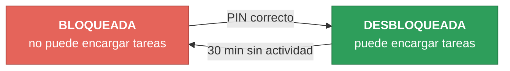

*Si fallas el PIN varias veces seguidas, tendrás que esperar un poco antes de volver a
intentarlo.*

- Al arrancar (`tony chat` o la app de escritorio) se pide el PIN; en la app aparece un diálogo con
  el campo oculto y un botón de cancelar.
- Tras el 3.er PIN erróneo seguido hay que esperar 10 s, tras el 4.º 30 s y a partir del 5.º 60 s;
  un intento durante la espera se rechaza sin comprobarlo ni contarlo. Un PIN correcto pone el
  contador a cero.
- Modo solo conversación: si se cancela el PIN, o no existe `config/edith.lock` (o no es un hash
  válido), el agente de conversación sigue respondiendo pero `delegate` devuelve
  `{"error": "locked"}` sin pedir el PIN. Se puede desbloquear después con `/pin` en `tony chat` o
  con el botón «Introducir PIN» de la app.
- Rebloqueo por inactividad: si llega un mensaje `lock_after_min` minutos (30 por defecto) o más
  después del anterior, la sesión se bloquea y el PIN se pide en el siguiente `delegate`, que
  espera hasta `confirm_timeout_s`; cancelar o no responder devuelve `{"error": "locked"}`. La
  inactividad se mide entre mensajes, no entre pulsaciones.
- Con `pin_required: false` no se pide nunca.

#### Auditoría: `logs/audit.jsonl`

Cada veredicto añade una línea JSON con `ts` (UTC), `task_id`, `agent`, `tool`, `args_hash`
(SHA-256 de los argumentos en JSON canónico), `args_preview` (JSON canónico con secretos
enmascarados y claves con aspecto de secreto como `***`, recortado a 200 caracteres), `verdict`,
`rule`, `user_decision` (`allow|deny|timeout` en `confirm`, `null` en el resto), `duration_ms`
(incluida la espera de confirmación) y, en las confirmaciones, el id de la aprobación.

```bash
uv run tony audit --help
uv run tony audit                    # todas las líneas, de la más antigua a la más reciente
uv run tony audit --today            # solo las de hoy (fecha local)
uv run tony audit --verdict deny     # allow | confirm | deny
```

`tony audit` imprime una tabla con `ts`, `agent`, `tool`, `verdict`, `rule` y `user_decision`; sale
con código 0 aunque no haya líneas o el fichero no exista, y avisa por stderr de las líneas mal
formadas que omite.

### Aprobaciones y diario, en detalle

Cada `needs_confirmation` añade campos opcionales: `approval_id`, `args_digest`, `policy_version`,
`expires_at` y `preview` (vista previa tipada con secretos enmascarados y tamaño acotado). El
comando `confirm` acepta un `approval_id` opcional. El broker solo acepta respuesta para la
aprobación pendiente y sin caducar; antes de ejecutar, la llamada se cancela si sus argumentos
cambiaron y se evalúa de nuevo desde cero si cambió la política.

El diario `memory/actions.sqlite` lo escribe el proxy con los estados `prepared`, `dispatched`,
`succeeded`, `failed` y `outcome_unknown`. Al arrancar, las filas `dispatched` huérfanas pasan a
`outcome_unknown`. Las llamadas nunca se reproducen. `tony actions list [--state S] [--limit N]`
las lista (más recientes primero) y `tony actions show <CALL_ID>` imprime todos sus campos.

### Aclaraciones y fuentes, en detalle

`tony.ask_user` recibe `{question, options?}` y devuelve la respuesta como texto. El evento
`clarification_requested{request_id, task_id, agent, question, options}` y el comando
`AnswerClarification{request_id, answer}` son un canal aparte del de confirmación; una respuesta
nunca es una aprobación. Si no hay respuesta en `confirm_timeout_s`, la tarea se cancela o no hay
canal, la tool devuelve el error `no answer from the user`. En `tony chat` y `tony run` se imprime
la pregunta con opciones numeradas y un número elige una opción. La tool está exenta del
`tool_timeout_s` por llamada.

Las fuentes (`datos.fuentes`) tienen `connector`, `id`, `title`, `retrieved_at` y `excerpt` (el
texto literal que respalda el dato, de hasta 300 caracteres). El
runner las valida contra los textos de los resultados correctos de tools no nativas de la tarea y
descarta las que no tienen respaldo, con una línea de aviso en `pasos`. La CLI imprime después del
resultado:

```
Fuentes:
- gmail · Factura de octubre
```

### Uso del CLI, en detalle

```bash
uv run tony run --help
uv run tony run viernes "Lista mis notas"
```

`tony run <agente> "<tarea>"` ejecuta un agente `worker` con la tarea como `objetivo` e imprime en
stdout un único objeto JSON `{resumen, datos, pasos, errores}`. Sale con código 0 si `errores` está
vacío, 1 si el resultado trae errores y 2 si la definición del agente o la tarea no son válidas (el
error, con fichero y campo, va a stderr).

Límites: 30 s de conexión por servidor MCP (si falla, se reintenta en segundo plano 3 veces, tras 5, 15 y 30 s, hasta que conecte); el tiempo por llamada a tool y por tarea sale de
`limits` en la política (20 s y 300 s por defecto). Cada tarea deja su registro en
`logs/tasks/<task_id>.jsonl` y el stderr de cada servidor stdio en `logs/mcp/<servidor>.log`. El
evento `token_usage` del log incluye `cache_read_tokens`, `cache_creation_tokens` y `cost_usd`.

### App de escritorio

```bash
uv run tony              # sin subcomando abre la ventana (uv run tony --help sigue mostrando la ayuda)
```

Una sola ventana nativa (sin barra del sistema operativo: la dibuja la propia interfaz, con
arrastre y botones minimizar/maximizar/cerrar propios) que muestra la interfaz web de Tony,
compilada en `tony/apps/desktop/web/dist/` y cargada desde un fichero local: no se abre ningún
servidor ni puerto, ni un navegador aparte. El núcleo (Jarvis, Viernes, Edith) corre en su propio
hilo; la página solo envía comandos JSON (validados antes de llegar al núcleo) y recibe eventos, de
modo que un fallo del núcleo (modelo caído, servidor MCP roto, excepción) se muestra como error en
el chat y la ventana sigue abierta. El audio no pasa por la página: el núcleo solo le envía niveles
(`voice_level`) para animar el orbe.

- **Orbe**: en el centro, detrás del chat. Su estado sale de los eventos (ver [el orbe](#el-orbe-en-qué-estado-está-tony)
  más arriba); su tamaño sigue el nivel del micrófono o de la voz. Sin WebGL el tema Holo muestra un
  orbe estático y el resto funciona igual.
- **Chat**: mensajes por agente, con el color de cada uno (ver la [tabla de agentes](#qué-es)) y el
  resto (incluido el usuario) en gris. Las respuestas crecen a medida que llegan y se muestran como
  Markdown (con tablas; el HTML en bruto se escapa). Intro envía el mensaje; el selector
  `auto/voice/text/both` cambia el modo de respuesta y el botón de micrófono escucha una frase (ver
  [Voz](#voz)).
- **Actividad** (plegable): cada tarea delegada con su agente y objetivo, sus llamadas a tools con
  veredicto (y decisión del usuario), las de subagentes agrupadas bajo su nodo, mostradas con la
  más reciente primero.
- **MCPs** (plegable): cada servidor MCP conectado por agente, con su estado (en rojo si está
  caído) y un icono de información con una breve descripción. Al arrancar se comprueba en segundo
  plano cada servidor de Jarvis y Viernes; uno caído por fallo de conexión se reintenta solo (3 veces con espera creciente) y pasa a verde en cuanto conecta.
- **Edith** (plegable): la auditoría de hoy (fecha local, sin argumentos de las tools) filtrable
  por veredicto, con las llamadas nuevas añadidas al vuelo.
- **Tarjeta de confirmación**: sobre el orbe, con la pregunta pendiente y los botones «Permitir»,
  «Denegar» y, cuando procede, «Permitir siempre»; el foco empieza en «Denegar».
- **Ajustes de audio y apariencia**: el botón de ajustes abre la elección de dispositivos de audio
  y, en «Apariencia», el tema visual (Holo Ámbar, Aurora o Instrumento). La elección se guarda en
  el almacenamiento local de la ventana; si el valor guardado no es válido se vuelve a Holo Ámbar.

«Permitir siempre» solo aparece si ninguna regla `deny` de la política tiene un patrón que encaje
con la tool pendiente (sin mirar sus condiciones `when`); por eso nunca se ofrece, por ejemplo,
para `shell.run`. Al pulsarlo se ejecuta la llamada y se añade como primera regla de
`agents/<guard>/policy.yaml`:

```yaml
- match: filesystem.delete_file
  verdict: allow
  id: user-always/filesystem.delete_file
```

A partir de ahí esa tool se permite sin preguntar en la tarea actual y en las siguientes. La
política se valida antes de sustituir el fichero de forma atómica; al reescribirla se pierden los
comentarios del YAML (el orden y el contenido de las reglas se conservan). Para revocarlo usa
`tony policy revoke <tool>` o borra la regla `user-always/<tool>` del fichero. Si no se puede
escribir la política, la llamada se permite una vez y se muestra un error.

El PIN se pide en una capa sobre la página al arrancar (y en el rebloqueo por inactividad) con el
campo oculto, la cuenta atrás de la espera tras fallos y un botón de cancelar; sin
`config/edith.lock` solo muestra cómo crear el PIN con `tony pin set`. Mientras Edith esté
bloqueada, el botón «Introducir PIN» vuelve a abrirla. El PIN se envía una sola vez y el campo se
vacía al momento; la página no lo guarda. Cerrar la ventana cancela la tarea en curso, cierra los
servidores MCP y detiene el núcleo.

Si la interfaz no está compilada, la ventana muestra la orden para compilarla
(`npm --prefix tony/apps/desktop/web ci && npm --prefix tony/apps/desktop/web run build`); la voz,
la bandeja, la instancia única, `tony --focus`, el atajo y las notificaciones siguen funcionando.
La página está aislada: se le deniegan todos los permisos (micrófono, cámara, ubicación,
notificaciones…), no puede salir de su `index.html` ni cargar recursos remotos, y los enlaces
`http`/`https` de las respuestas se abren en el navegador del sistema (los demás se ignoran).

#### Integración con el escritorio

Requiere el extra `desktop` (`uv sync --extra desktop`) para el atajo global y las notificaciones;
sin él la app funciona igual y lo indica en el chat cuando haría falta.

- **Bandeja del sistema** (`desktop.tray: true` por defecto en `config/tony.yaml`): icono con
  «Mostrar/Ocultar» (oculta o muestra la ventana; el núcleo sigue trabajando) y «Salir» (igual que
  cerrar la ventana). El icono y el tooltip muestran el estado: gris `Tony — en espera`, azul
  `Tony — trabajando` (turno o tarea en curso) y ámbar `Tony — esperando confirmación`. Con
  `desktop.tray: false`, o si el escritorio no ofrece bandeja, no se crea.
- **Una sola instancia**: un segundo `tony` muestra y levanta la ventana ya abierta y termina con
  código 0. El canal es un socket local solo accesible por su usuario
  (`$XDG_RUNTIME_DIR/tony-desktop.sock`) que solo acepta los mensajes `show` y `focus`.
- **`tony --focus`**: muestra, restaura y enfoca la ventana y empieza a escuchar (si no hay
  ninguna abierta, abre la app y escucha en cuanto la voz esté `ready`; si la voz no está
  disponible lo dice en el chat). `--focus` no se combina con subcomandos.
- **Atajo global en X11** (`desktop.hotkey`, `Super+J` por defecto): hace lo mismo que
  `tony --focus`. Sintaxis: modificadores `Super` (o `Meta`/`Win`), `Ctrl`, `Alt`, `Shift` unidos
  con `+` y una tecla (letra, dígito, `F1`–`F12`, `Space`, `Enter`, `Tab` o `Esc`), sin distinguir
  mayúsculas: `Ctrl+Alt+Space`, `Super+F2`. Un atajo inválido se muestra como error nombrando
  `desktop.hotkey` y la app sigue funcionando. Solo se registra con `XDG_SESSION_TYPE=x11`.
- **Wayland**: no hay atajos globales para aplicaciones (ver [Atajos en
  Wayland](#atajos-en-wayland)).
- **Notificaciones**: si Edith espera una confirmación con la ventana oculta o minimizada, se
  muestra una notificación nativa `Tony — Edith` con la pregunta (con los secretos ya enmascarados;
  puede verse en la pantalla de bloqueo). Al pulsarla se abre la ventana en la tarjeta de
  confirmación con el foco en «Denegar». Sin servicio de notificaciones se muestra un error
  `notifications` una vez y la tarjeta de la ventana sigue funcionando.

##### Atajos en Wayland

Cree un atajo personalizado del escritorio que ejecute `tony --focus` (con el Flatpak,
`flatpak run io.github.renzoramosdev.Tony --focus`):

- KDE Plasma: Preferencias del sistema → Teclado → Accesos rápidos → Añadir nuevo → Orden o
  script, con esa orden y el atajo que prefiera (p. ej. Meta+J).
- GNOME: Configuración → Teclado → Ver y personalizar atajos → Atajos personalizados → «+», con
  esa orden y el atajo que prefiera.

### Voz

La voz es local: micrófono a 16 kHz mono, detección de voz con Silero VAD, transcripción en
español con faster-whisper (`voice.stt`, `faster-whisper/small` en `int8` sobre CPU) y síntesis con
Kokoro a 24 kHz.

Se instala con el extra `voice` (torch solo CPU) y necesita la biblioteca del
sistema PortAudio (`portaudio` en Fedora, `libportaudio2` en Debian/Ubuntu):

```bash
uv sync --extra voice --extra desktop
```

Al abrir la app se cargan en segundo plano el VAD, el modelo de transcripción y las voces de los
tres agentes; la ventana responde mientras tanto. El estado se publica como evento `voice_state`:
`loading`, `ready`, `listening` o `unavailable` con el motivo (extra no instalado, `voice.stt`
distinto de `faster-whisper/<modelo>`, `voice.vad` distinto de `silero` o un fallo al cargar). Sin
voz todo sigue funcionando por texto y el tooltip del micrófono dice por qué.

Los dispositivos de entrada/salida que se listan son los reales del sistema (vía PipeWire), los
mismos que ves en los ajustes de audio — no las duplicidades internas de ALSA ni los flujos de
otras apps. La detección se hace fuera del bucle del núcleo (`pw-dump`, 5 s de límite) y varias
peticiones simultáneas comparten una sola. Si eliges un dispositivo, se valida su tipo, el nombre
se compara exacto y, si no, sin distinguir mayúsculas ni espacios; si acaba usándose el
predeterminado en lugar del pedido, se avisa en `input_fallback_warning` / `output_fallback_warning`.

Micrófono: con la voz `ready`, un clic escucha **una** frase: se cierra tras 700 ms de silencio (o
a los 30 s), se transcribe y se envía a Jarvis como un mensaje escrito, con origen `voice` (en el
chat aparece como «Tú (voz)»). Mientras escucha el botón muestra «Escuchando…» y otro clic lo para;
sin hablar en 10 s se cierra solo. Empezar a escuchar corta lo que Tony esté diciendo, así que
nunca se graba a sí mismo. `cancel` detiene también la voz y la escucha, y una escucha cancelada
nunca llega a transcribirse.

Modo de respuesta y voz:

| Modo | Habla | Escribe |
|------|-------|---------|
| `voice` | sí | no |
| `text` | no | sí |
| `both` | sí | sí |
| `auto` | si el mensaje llegó por voz | si llegó escrito |

Si la voz no está `ready` el turno siempre se escribe. En un turno que solo habla, el chat muestra
la respuesta completa al terminar el turno.

Qué se dice: la respuesta se parte en frases mientras llega y cada frase suena en cuanto está
completa. Los bloques de código y las tablas Markdown se sustituyen por «Te lo dejo en pantalla.»;
las respuestas de más de 600 caracteres se dicen como sus dos primeras frases seguidas de esa misma
frase; las marcas Markdown (negritas, títulos, viñetas, comillas invertidas, destinos de enlaces)
no se leen.

Voces por agente (`voice.tts` de cada `agent.md`): Jarvis `kokoro/em_alex`, Viernes `kokoro/
ef_dora` y Edith `kokoro/ef_dora,bf_emma`. Una lista separada por comas es una mezcla: la media de
esas voces de Kokoro.

Edith por voz: si una confirmación queda pendiente durante un turno que habla, Edith la pregunta
con su voz (sin la parte `Regla: …`) y, cuando termina de sonar, el micrófono escucha la respuesta.
Solo «Sí, Edith» (sin importar mayúsculas, tildes ni puntuación: `si edith`) permite; cualquier
otra frase deniega; el silencio hasta `confirm_timeout_s` es `timeout`. El aviso de la ventana sigue
disponible y responder ahí cierra la escucha.

Métricas de latencia (opcionales): un registrador en proceso, apagado por defecto, anota las marcas
de cada turno de voz (fin de voz, cierre de captura, inicio y fin de transcripción, primer token,
inicio y fin de síntesis, inicio de reproducción) y un muestreador mide el retraso del bucle de
eventos. El informe da p50 y p95 por etapa, separando el primer turno tras la carga (frío) de los
siguientes (caliente). La prueba de latencia (`tests/voice/test_latency.py`) ejecuta 20 vueltas e
imprime el informe sin afirmar ningún objetivo. Solo se guardan marcas de tiempo: nunca audio ni
texto.

Privacidad: el audio nunca sale del proceso, no se guarda en disco ni se publica como evento; solo
el texto transcrito llega al chat y al historial.

### Conversación: `tony chat`

```bash
uv run tony chat --help
uv run tony chat
uv run tony chat --resume [ID]
uv run tony agents       # slot, agente, rol, modelo y voz de front, worker y guard
```

`tony chat` lee un mensaje por línea y se lo envía al agente de conversación (`front` de
`config/tony.yaml`, Jarvis por defecto); la respuesta aparece en stdout a medida que llega, con el
prefijo `Jarvis: `. Las líneas vacías se ignoran y el chat termina con `/salir` o al acabar la
entrada. Si el modelo falla se muestra `tony: <error>` en stderr y el chat continúa.

Jarvis encarga las tareas a Viernes con la tool `delegate` y explica su resultado; si una tarea
tarda más de 3 s se muestra una vez una de 50 frases de espera elegida al azar (nunca la misma dos veces seguidas), por ejemplo `Un momento, señor; estoy en ello.`. Las confirmaciones de
Edith salen por stderr con el prefijo `Edith: ` y se responden en la misma entrada (una línea
tardía tras agotarse la espera llega a Jarvis como mensaje, no se pierde). Las aclaraciones de
Viernes salen igual, con opciones numeradas.

Comandos y prefijos:

- `/pin`: vuelve a pedir el PIN de Edith (por ejemplo tras cancelarlo).
- `/salir`: termina el chat.
- `/v <mensaje>` y `/t <mensaje>`: responden a ese mensaje por voz o por texto sin cambiar el modo
  guardado (el prefijo se quita antes de enviarlo).

Modo de respuesta: `auto`, `voice`, `text` o `both`. Se cambia pidiéndoselo a Jarvis (tool
`set_reply_mode`) o con el selector de la app, y se guarda como `reply_mode: <modo>` en
`memory/preferences.md`; si no hay línea válida se usa `reply_mode` de `config/tony.yaml`. En
`tony chat` las respuestas siempre se escriben; la voz solo existe en la app de escritorio (ver
[Voz](#voz)).

Memoria local (ignorada por git):

- `memory/preferences.md`: preferencias que Jarvis guarda con la tool `remember` (líneas
  `- <texto>`, con secretos enmascarados; guardar la misma línea otra vez no cambia el fichero). Se
  añade a su prompt en cada mensaje, así que las ediciones a mano se aplican al siguiente mensaje.
- `memory/conversations.sqlite`: historial (tabla `messages`). Cada arranque de `tony chat` o de la
  app abre una conversación nueva (o retoma una con `--resume`); a cada mensaje se le envían los 20
  mensajes anteriores de la conversación actual, con el tope de `history_max_chars`. Los resultados
  de Viernes no se guardan como mensajes.
- `memory/actions.sqlite`: el diario de acciones.
- `memory/undo/<call_id>`: contenido previo de las escrituras de ficheros.
- `memory/routines.sqlite`: rutinas y sus ejecuciones.

### Servidores MCP: `tony mcp`

```bash
uv run tony mcp --help
uv run tony mcp add notas npx --arg -y --arg @modelcontextprotocol/server-filesystem \
    --arg '${HOME}/notas' --env LOG=1 --agent viernes
uv run tony mcp add remoto https://example.test/mcp \
    --header 'Authorization=Bearer ${REMOTE_TOKEN}' --agent viernes
uv run tony mcp add notas npx --agent viernes/resumidor   # tool.json de un subagente
uv run tony mcp list                  # todos los agentes y subagentes
uv run tony mcp list --agent viernes
```

`tony mcp add <nombre> <comando-o-url> --agent <agente>` añade el servidor al `tool.json` del
agente (o de `<agente>/<subagente>`) sin tocar el resto de claves ni su orden e imprime
`added <nombre> to <fichero>`. Un destino que empieza por `http://` o `https://` crea una entrada
HTTP (`url` y `--header K=V` repetible); cualquier otro, una entrada stdio (`command`, `--arg` y
`--env K=V` repetibles). Mezclar opciones de otro transporte, un par sin `=` o con la clave vacía,
un nombre ya existente, un nombre inválido (`tony`, con `.` o `__`), un agente inexistente o
guardián, o un resultado que no valide terminan con error y dejan el fichero intacto. Las escrituras
se serializan con un bloqueo exclusivo sobre `tool.json.lock` (espera como máximo 5 s) y sustituyen
el fichero de forma atómica (JSON UTF-8 con sangría de 2 espacios).

Los `${VAR}` se escriben tal cual y se resuelven al conectar, desde el entorno o `config/.env`. Si
la clave de un `--header` o `--env` parece un secreto (`token`, `key`, `secret`, `password`,
`passwd`, `authorization`, `pin`) y su valor no usa `${...}`, la entrada se escribe igualmente y
stderr avisa recomendando un `${VAR}` definido en `config/.env`; los valores nunca se imprimen.

`tony mcp list [--agent <agente>]` conecta cada servidor declarado con las mismas reglas que una
tarea, imprime la tabla `agent server state tools` (`ok` o `error: <motivo enmascarado>`, y el
número de tools) y cierra todas las conexiones. Sale con 0 aunque haya servidores caídos; un
`--agent` inexistente o un `tool.json` inválido (que se nombra en stderr mientras se listan los
demás) dan un código distinto de 0.

### Recuperación y rutinas: `tony recover` y `tony routines`

Nada de esto concede permisos: reanudar, deshacer y programar pasan por Edith como cualquier otra
llamada (confirmaciones y PIN incluidos) y no reutilizan aprobaciones antiguas.

```bash
uv run tony recover list
uv run tony recover resume <TASK_ID>
uv run tony recover undo <CALL_ID>
```

- `recover list` muestra las tareas canceladas, con timeout o interrumpidas (sin evento final y con
  más de 15 minutos sin escribir), con sus acciones `succeeded` etiquetadas `undoable` o
  `not undoable`. `--limit N` (20 por defecto).
- `recover resume` lanza la petición original como tarea NUEVA (otro id), con una nota al inicio de
  `contexto` que lista las acciones ya hechas y pide no repetirlas. El inicio de la tarea registra
  `resumed_from` con el id original.
- `recover undo` restaura un `filesystem.write_file` con una escritura nueva y guardada, solo si el
  fichero sigue igual que tras la acción; si no, responde `file changed since the action`. Los
  contenidos previos (hasta 1 MB, UTF-8) están en `memory/undo/<call_id>`.

```bash
uv run tony routines add manana --time 08:30 --prompt "resume mis tareas" --weekdays mon,tue,wed,thu,fri --tz Europe/Madrid
uv run tony routines list
uv run tony routines inbox --limit 10
uv run tony routines disable 1   # también: enable, remove
```

Una rutina ejecuta su `--prompt` cada día a la hora local indicada (por defecto todos los días y la
zona del sistema) como tarea de un worker con origen `routine`. **Las rutinas solo se ejecutan
mientras `tony chat` o la app de escritorio están en marcha**; los comandos `tony routines` solo
editan definiciones y leen registros (`memory/routines.sqlite`). El planificador revisa cada 30 s,
ejecuta una vez cada ocurrencia, guarda como `skipped` las que llevan más de 12 h de retraso y las
deja en `queued` mientras la sesión de Edith está bloqueada (nunca pide el PIN). Una confirmación
sin respuesta se deniega por el timeout habitual. El resultado se lee con `routines inbox`. El
evento `task_started` lleva el campo `origin` (por ejemplo `routine`).

### Música

Viernes puede poner música en tu PC: «ponme Bohemian Rhapsody», «añade otra a la cola», «sube el
volumen», «qué suena». Lo hace el servidor MCP `music` (`python -m tony.core.music`, declarado en
`agents/viernes/tool/tool.json`), que busca la canción con `yt-dlp` y la reproduce con `mpv` sin
ventana, solo audio. No hace falta ninguna clave ni cuenta. Las tools son `music_search`
(busca y devuelve el título sin reproducir), `music_play`, `music_queue`, `music_pause`, `music_resume`, `music_next`, `music_previous`, `music_volume`
(0 a 100), `music_now_playing` y `music_stop`; la skill `musica` le explica a Viernes cuándo usar
cada una. Poner una canción siempre se confirma: Viernes busca con `music_search`, llama a
`music_play`/`music_queue` con el título encontrado y Edith (regla `confirm` sobre esas dos tools)
te muestra ese título para que digas sí o no; el resto (`music.*`, incluida la búsqueda) pasa sin
preguntar.

Suena exactamente lo que aprobaste: `music_play` y `music_queue` reutilizan la pista que ya resolvió
`music_search` cuando la consulta coincide con el título devuelto (válida 10 minutos, hasta 20
pistas); si la URL en caché caducó, vuelven a resolver y solo aceptan un resultado con el mismo
título.

Necesitas tener instalados `mpv` y `yt-dlp`. En Bazzite (sistema inmutable):

```bash
rpm-ostree install mpv        # después hay que reiniciar para activarlo
mkdir -p ~/.local/bin
curl -L https://github.com/yt-dlp/yt-dlp/releases/latest/download/yt-dlp -o ~/.local/bin/yt-dlp
chmod +x ~/.local/bin/yt-dlp
```

Si falta alguno, Viernes lo dice en `errores` («instala mpv» / «instala yt-dlp») y `tony doctor` lo
marca. `mpv` queda escuchando en un socket de `$XDG_RUNTIME_DIR` (`tony-mpv.sock`) y se arranca
solo al pedir la primera canción. Con el Flatpak, `mpv` y `yt-dlp` tienen que ser visibles dentro
del sandbox.

### Recarga en caliente

La app de escritorio y `tony chat` vigilan (con `watchfiles`) cada `agents/<agente>/tool/tool.json`,
cada `agents/<agente>/subagents/<sub>/tool/tool.json` y el `agents/<guard>/policy.yaml`, también los
creados después de arrancar; el resto de ficheros (incluido `tool.json.lock`) se ignora. `tony run`
no vigila nada: cada ejecución ya lee los ficheros al empezar.

- Un cambio válido de `policy.yaml` se aplica a la siguiente llamada a una tool, incluso dentro de
  una tarea en curso (y una aprobación pendiente se evalúa de nuevo desde cero). Los `limits`
  (salvo `confirm_timeout_s`) se aplican desde la siguiente tarea y `auth` desde la siguiente
  sesión.
- Un cambio válido de un `tool.json` se usa en la siguiente tarea o turno; la tarea en curso
  conserva los servidores con los que empezó. Solo se conectan (y se cierran) los servidores
  añadidos o modificados para actualizar su estado; los eliminados aparecen caídos con el motivo
  `removed from tool.json`.
- Un cambio inválido (YAML o JSON roto, error de esquema o fichero borrado) mantiene la última
  configuración válida, publica un evento `error` (origen `reload`) y escribe en stderr
  `tony: warning: <fichero>: <error>`. El siguiente guardado válido se aplica con normalidad.

Las skills y los subagentes no necesitan vigilancia: se leen del disco en cada tarea o turno.

## Flatpak

`packaging/` contiene el manifiesto `io.github.renzoramosdev.Tony` (runtime KDE 6.8 con Python
3.12, PortAudio compilado como módulo y Tony con los extras `voice` y `desktop`), el fichero
`.desktop` (con la acción «Escuchar», `tony --focus`) y el icono. Es para compilar en local: las
dependencias de Python se descargan durante la compilación y se verifican con los hashes de
`packaging/requirements.txt`, y la interfaz web se compila dentro de la compilación con la
extensión `org.freedesktop.Sdk.Extension.node20` (`npm ci` y `npm run build`, con los paquetes
fijados por `package-lock.json`). Tras cambiar dependencias de Python, regenérelo:

```bash
uv export --frozen --no-dev --extra voice --extra desktop --no-emit-project -o packaging/requirements.txt
flatpak-builder --user --install --force-clean build-dir packaging/io.github.renzoramosdev.Tony.yml
flatpak run io.github.renzoramosdev.Tony            # abre la app
flatpak run io.github.renzoramosdev.Tony --focus    # la levanta y escucha
```

Permisos del sandbox: Wayland (con X11 de reserva), PulseAudio (micrófono y altavoces), red, el
directorio personal, el servicio de notificaciones, la GPU (`--device=dri`, para el WebGL del orbe;
sin ella se ve el orbe estático) y `--env=QTWEBENGINE_DISABLE_SANDBOX=1`: el sandbox interno de
Chromium no puede arrancar dentro de bubblewrap con PySide6 instalado por pip, así que se desactiva
solo dentro del Flatpak (bubblewrap sigue siendo el sandbox exterior y la página solo ejecuta su
propio código local). Para usar otro `TONY_HOME`:

```bash
flatpak override --user --env=TONY_HOME=$HOME/Tony io.github.renzoramosdev.Tony
```

Servidores MCP dentro del sandbox: los que se lanzan con `npx` necesitan Node.js dentro del
Flatpak, que no viene incluido; use preferiblemente servidores que se lancen con `uvx` (Python: el
binario estático de `uv` instalado en `~/.local/bin` es accesible gracias a `--filesystem=home`;
indique su ruta completa como orden), o instale Node en el sandbox. Para el atajo de teclado en
Wayland, vea [Atajos en Wayland](#atajos-en-wayland).

## Estructura del repositorio

```
agents/                 jarvis, viernes y edith: agent.md, tool.json, skills, policy.yaml
config/                 tony.yaml, .env.example
tony/
├── apps/
│   ├── cli/            la CLI (chat, run, doctor, policy, recover, routines...)
│   └── desktop/        la ventana nativa y su interfaz web (React + TypeScript)
│       └── web/src/
│           ├── orb/    orbe WebGL (Holo) y renderizadores Canvas 2D (Aurora, Instrumento)
│           └── theme/  temas visuales y su almacenamiento
└── core/
    ├── orchestrator/   el bucle de tareas, el proxy de tools y los comandos
    ├── guard/          política, confirmaciones, aprobaciones, PIN y auditoría
    ├── mcp/            conexiones a conectores, arranque concurrente y aislamiento
    ├── memory/         historial, diario de acciones, snapshots de deshacer, preferencias
    ├── recovery/       listar, reanudar y deshacer tareas
    ├── automation/     rutinas y planificador
    ├── clarification/  aclaraciones en mitad de una tarea
    ├── evidence/       fuentes y su validación
    ├── diagnostics/    tony doctor
    ├── voice/          voz local y métricas de latencia
    ├── music/          el servidor MCP de música
    └── config/ events/ loader/ logging/
memory/  logs/          datos locales (ignorados por git)
openspec/               especificaciones y cambios (SDD)
evals/                  casos de la política
packaging/              Flatpak
docs/                   diagramas y resúmenes visuales
```

## Cómo se desarrolla

El proyecto sigue desarrollo guiado por especificaciones con [OpenSpec](https://openspec.dev):
cada cambio se propone en `openspec/changes/`, se implementa con TDD (primero el test que falla) y
se archiva al terminar. Los cambios recientes (aprobaciones y diario, recuperación y rutinas,
aclaraciones y evidencia, aislamiento de conectores, contexto acotado, fiabilidad de música y
dispositivos, métricas de voz) están ahí con su propuesta y su diseño. Hay también resúmenes
visuales en `docs/`: `novedades-tony.html`, `mejoras-tony.html` y `ahorro-tokens.html`.

## Desarrollo

```bash
uv run pytest            # offline; omite los tests marcados evals, voice y web
TONY_EVALS=1 uv run pytest tests/evals   # modelo real (requiere credenciales y npx)
uv run ruff check && uv run ruff format --check
npm --prefix tony/apps/desktop/web ci     # dependencias de la interfaz (una vez)
npm --prefix tony/apps/desktop/web test   # tests de la interfaz (vitest, sin GPU ni red)
npm --prefix tony/apps/desktop/web run build
uv run pytest -m web     # carga la interfaz compilada en Qt WebEngine sin pantalla
```
